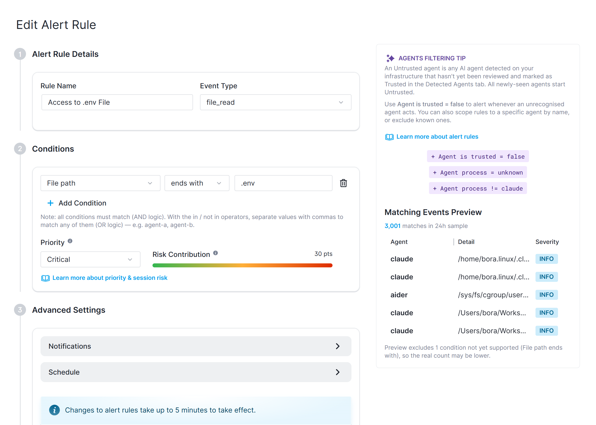
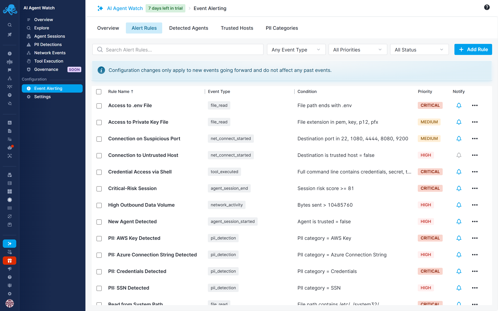

title: Alert Rules
description: Defining what counts as risky AI agent activity and getting notified when it happens

An alert rule watches for events of a specific type and, when its conditions match, tags the event with a priority and notifies you if you've asked it to. This is how AI Agent Watch turns a stream of raw events into "this is worth your attention."

## How a rule is built

Each rule has:

- A **name**
- A single **event type** it applies to (for example `pii_detection`, `tool_executed`, `net_connect_started`) - see [Captured Events](captured-events.md) for the full list
- One or more **conditions**, all of which must match (AND logic) for the rule to match an event
- A **priority** - Info, Medium, High, or Critical - applied to any event the rule matches
- A disabled rule is skipped entirely: it's never evaluated against incoming events, so it won't assign a priority or risk score to anything

A condition compares one field of the event against a value, using an operator: `=`, `!=`, `in`, `contains`, `starts with`, `ends with`, `>`, `>=`, `<`, `<=`. `in` and `contains` accept a comma-separated list of values, matching if any one of them applies. The available fields and valid operators depend on the event type the rule is scoped to.

## How matching works

An event can match more than one rule. When that happens, the **highest-priority match wins** - that's the priority and risk score recorded on the event - but every rule that matched is recorded, so you can still see all of them. An event that matches no rule is left at Info priority with no risk score. See [Risk Scores & Priorities](risk-scores.md) for how this feeds into scoring.

## Notifications

A rule only sends a notification if it's enabled, has notifications turned on, and has at least one recipient (email addresses and/or a notification hook) configured. Notifications can be [restricted to a schedule (specific days/time windows)](/docs/alerts/alert-scheduling/) and are throttled so a rule that keeps matching doesn't send a new alert every time - see [Alert Notification Hooks](/docs/alerts/alert-notifications/) for the supported delivery channels.

## Default rules

Enabling AI Agent Watch seeds your account with a set of default rules covering common risk patterns, including:

- New, untrusted agent detected (To be notified the moment an unrecognized agent shows up)
- Connection to an untrusted host (disabled by default)
- Connection to a suspicious port (for example 22, 1080, 4444, 8080, 9200)
- High outbound data volume in a session
- File writes/reads under sensitive system paths
- Access to `.env` files or private-key files
- PII detected for the most sensitive default categories (Credentials, AWS Key, SSN)
- Shell command execution, and credential-looking strings passed on a command line
- A session's overall [risk score](risk-scores.md#session-risk-score) crossing a critical threshold

## Governance events

Alert rules can match `exec_denied`, `file_access_denied`, and `net_denied` events emitted when a governance policy blocks an operation. Governance policies enforce restrictions on the host; alert rules assign event priorities and send notifications. Disabling notifications does not disable enforcement. See [Governance Policies](governance/policies.md#get-notified-when-a-policy-matches) for configuration.

## Cost alerts

Cost alerts help you spot unexpected spending, reduced cache reuse, and model calls whose costs cannot be calculated.

### Default cost alerts

AI Agent Watch includes the following default cost alert rules:

| Default rule | When it triggers |
|---|---|
| Automatic - Unknown Model Detected | At least one model call in the last hour has no matching pricing data. Evaluated separately for each provider and model. |
| Automatic - Unrecognized Service Tier Detected | At least one model call in the last hour reports an unrecognized service tier, so its cost cannot be calculated. Evaluated separately for each provider, model, and tier. |
| Automatic - Unsupported Billing Mode Detected | At least one model call in the last hour uses a fixed-fee tier, such as reserved or scale, that is not priced per token. Evaluated separately for each provider, model, and tier. |
| Automatic - Provider Cost Spike | A provider's total cost over six hours is more than 30% above its baseline. |
| Automatic - Agent Cost Spike | An agent's total cost over six hours is more than 30% above its baseline. Agents are compared separately by host, cluster, namespace, and agent type. |
| Automatic - Cache Hit Rate Drop | A model's cache hit rate over six hours is more than 40% below its baseline. Evaluated separately for each provider and model. |

The three baseline rules compare the current six-hour window with the median for the same hours over the previous seven days, excluding weekends. Provider and agent cost spikes use successfully priced calls; cache hit rate uses reported token usage.

### Manage cost alerts

Open **AI Agent Watch → Event Alerting → Cost Alerts** to review the defaults, adjust their conditions, or create your own rules. Notifications are enabled in the defaults; review recipients and schedules to control delivery. The three pricing-related rules have a minimum notification interval of 24 hours, while the baseline rules have a six-hour interval and send recovery notifications when activity returns to normal.

See [Cost Alerts](cost-alert-rules.md) for configuration and investigation steps. Cost alerts notify you about usage; they do not stop agents or enforce a spending cap. Use [governance policies](governance/policies.md) to control supported operations.
