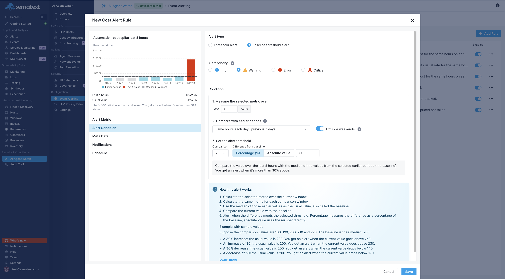
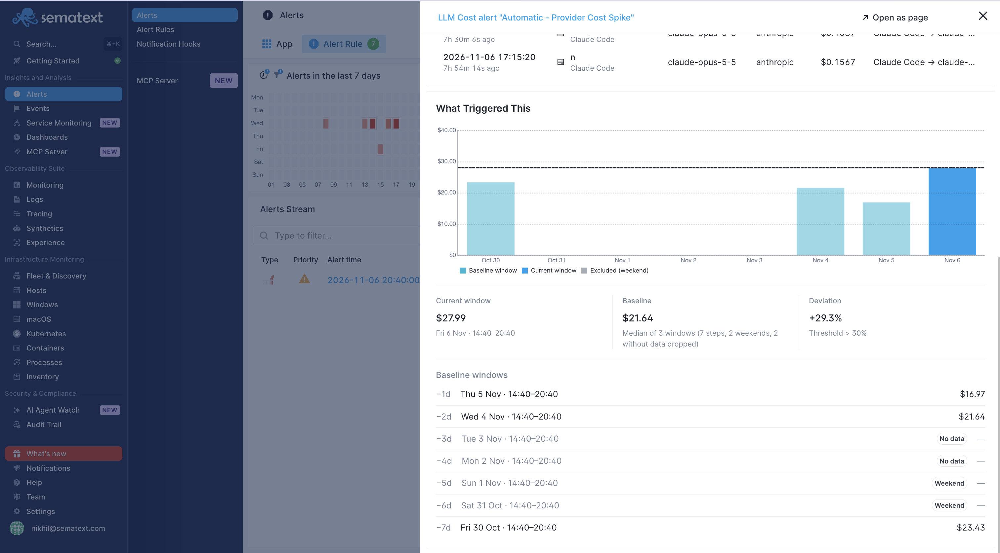

title: Cost Alerts
description: Configure fixed thresholds and baseline alerts for AI agent LLM usage and costs

Cost alerts evaluate aggregated AI Agent Watch data and notify you when it meets a condition. A cost alert does not stop an agent or enforce a spending limit.

Open **AI Agent Watch → Event Alerting → Cost Alerts** to manage rules.

AI Agent Watch includes [default cost alerts](alert-rules.md#default-cost-alerts) to help you spot unusual spending, reduced cache reuse, and usage with missing pricing. You can customize these rules or create your own.

## Choose an alert type

Select the alert type (**Threshold** or **Baseline**), then choose the metric, aggregation, and analyzing window.

- **Threshold:** Compare a metric aggregated over an analyzing window with a fixed limit. For example, alert when captured LLM cost exceeds $50 in an hour.
- **Baseline:** Compare the current window with the median of comparable earlier windows. For example, alert when a workstation agent's cost is more than 30% above its normal level.

Use filters to select the usage you care about and grouping to evaluate origins independently. For example, group by host to detect a workstation spike that would be diluted in an organization-wide total. Choose the metric, aggregation, and grouping supported by the rule form for your question.

## Baseline comparison windows

| Mode | Earlier windows used for comparison |
|---|---|
| SLIDING | Back-to-back windows over the previous 24 hours. Useful for recent changes. |
| ALIGNED | The same clock-time window on each of the previous seven days. Useful for daily work patterns. |
| WEEKLY | The same clock-time window on the same weekday over the previous four weeks. Useful for weekly patterns. |

Baseline rules compare against the median of eligible windows. Windows without data are excluded. **Skip weekends** is available for ALIGNED comparisons and excludes Saturday and Sunday windows from the baseline.

Choose a percentage deviation for proportional changes or an absolute deviation for a fixed difference in the metric's units.

## Investigate a cost alert

Open a cost alert from the LLM Costs report's alert feed. Review the triggered value, condition, and current value. For a baseline alert, inspect the historical windows, their median, and any excluded windows to understand the comparison.

Then inspect the contributing events from the alert's analyzing window, narrowed to its filters and the group that triggered it. Use the events' agent, host, model, and token usage to distinguish a model change from increased activity.

