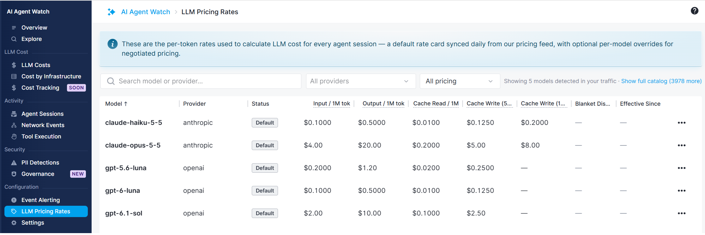
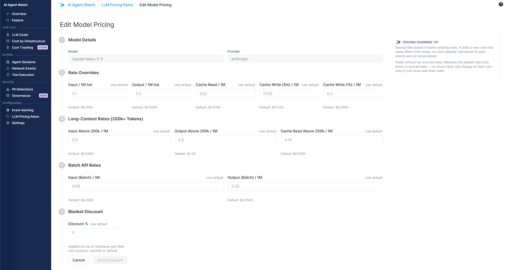

title: Pricing and Calculations
description: Configure model pricing and discounts and understand calculated LLM costs

Open **AI Agent Watch → LLM Pricing Rates** to review the model rate card and your account's overrides. Rates are displayed per **one million tokens**.

By default, **LLM Pricing Rates** lists models detected in your agents' usage. Select **Show full catalog** to browse pricing for other models and providers, compare rates, or configure pricing overrides before your agents start using them.

## Default pricing and account overrides

Default model prices are synchronized daily from LiteLLM's public pricing catalog. Each model/provider pair has its own rates. You can override supported rates to reflect negotiated pricing and apply a blanket percentage discount.

1. Find the provider and model in **LLM Pricing Rates** and open its edit action.
2. Enter overrides for the rates covered by your agreement. Leave other rates at their defaults.
3. Use **Use default** to clear an individual override when you want that field to follow the default rate card again.

### When pricing changes take effect

Saving an override creates pricing effective from that point onward. Previously calculated costs are not recalculated. Pricing is selected using the usage event's timestamp, so a new negotiated rate does not rewrite historical spending.

## Missing and partial costs

Not every captured request can be priced. Usage events include a pricing status so missing cost is distinguishable from a successful zero-cost calculation.

- **Unknown model:** There is no matching default pricing entry for the reported provider/model.
- **Unsupported billing mode:** Reserved and scale service tiers are not priced as pay-as-you-go usage.
- **Unknown service tier:** An unrecognized tier is left unpriced rather than assigned a guessed rate.

At session end, costs from captured, priced calls are summed. The session is marked `PARTIAL_COST` if some captured calls could not be priced.
