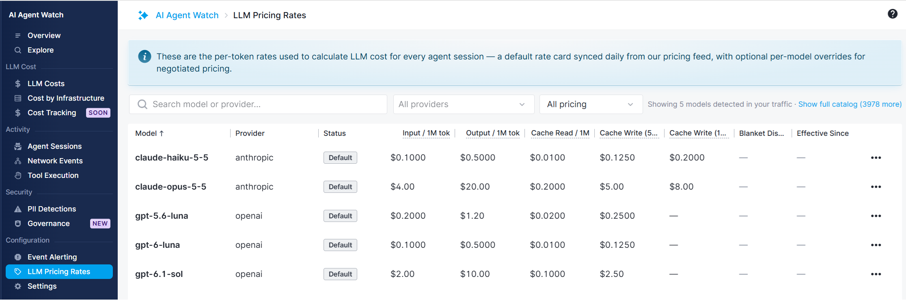
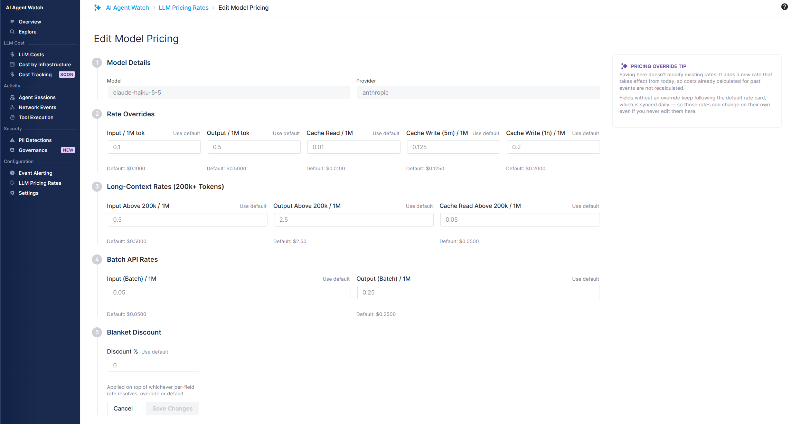

title: Pricing and Calculations
description: Configure model pricing and discounts and understand calculated LLM costs

Open **AI Agent Watch → LLM Pricing Rates** to review the model rate card and your account's overrides. Rates are displayed per **one million tokens**.

By default, **LLM Pricing Rates** lists models detected in your agents' usage. Select **Show full catalog** to browse pricing for other models and providers, compare rates, or configure pricing overrides before your agents start using them.

## Understanding estimated costs

Costs are estimates calculated from reported token usage and the applicable model rates. On Linux, AI Agent Watch uses the service tier reported in each LLM usage event. On macOS and Windows, where a service tier is not reported, it uses standard API rates. Account pricing overrides and discounts apply where configured.

Reported token counts are exact. The estimated dollar amount may differ from what your provider charges, particularly if you have a subscription, reserved capacity, credits, or another negotiated billing arrangement.

## Subscriptions, reserved capacity, and scale tiers

### Reserved and scale tiers

If a usage event reports a `reserved` or `scale` tier, AI Agent Watch shows its token usage but leaves the cost uncalculated and marks it **Unsupported billing mode** (`UNSUPPORTED_BILLING_MODE`). These arrangements cannot be represented by the supported per-token calculation. This does not mean the agent used no tokens or that its usage was free. Pricing overrides do not turn these tiers into supported per-token billing modes.

When you see this status, check whether the reported tier matches your provider agreement. You can still compare token consumption across agents, models, machines, and sessions to understand where your capacity is being used. If the arrangement is expected, adjust the default **Unsupported Billing Mode Detected** alert to exclude that model and provider. See [Default Cost Alerts](../alert-rules.md#default-cost-alerts) and [Cost Alerts](../cost-alert-rules.md) for the included rules and configuration.

### Fixed monthly subscriptions

If you pay a fixed monthly subscription, calculated API costs do not represent additional charges or divide your subscription fee between sessions. The reports still help you see which machines and sessions consume the most tokens, which models your team relies on, and whether usage is growing.

For example, you can investigate whether one large session accounts for most of the day's token consumption or whether increased usage is spread across the team. Use [LLM Usage](reports.md#llm-usage) and [Session Usage](reports.md#session-usage) to compare consumption even when your bill stays the same each month.

## Default pricing and account overrides

Default model prices are synchronized daily from LiteLLM's public pricing catalog. Each model/provider pair has its own rates. You can override supported rates to reflect negotiated pricing and apply a blanket percentage discount.

1. Find the provider and model in **LLM Pricing Rates** and open its edit action.
2. Enter overrides for the rates covered by your agreement. Leave other rates at their defaults.
3. Use **Use default** to clear an individual override when you want that field to follow the default rate card again.

### When pricing changes take effect

Saving an override creates pricing effective from that point onward. Previously calculated costs are not recalculated. Pricing is selected using the usage event's timestamp, so a new negotiated rate does not rewrite historical spending.

## Missing and partial costs

When AI Agent Watch cannot calculate a cost for an `llm_usage` event, its pricing status explains why. Token usage remains available even when the cost is missing.

- **Unknown model:** No matching pricing entry exists for the reported model and provider.
- **Unsupported billing mode:** The event reports a reserved or scale service tier, which cannot be priced using the supported per-token calculation.
- **Unknown service tier:** The event reports a service tier that Sematext does not recognize, so its cost is left uncalculated.

At session end, costs from successfully priced calls are added together. If some captured calls could not be priced, the session is marked `PARTIAL_COST` to indicate that its total includes only the priced calls.
