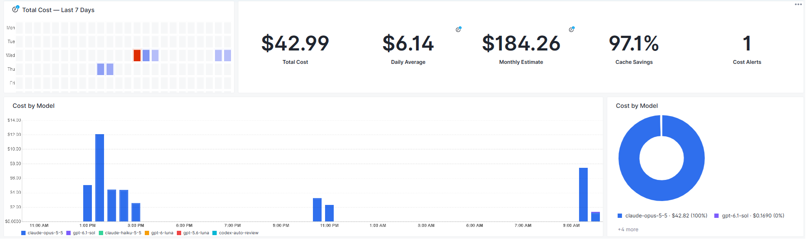
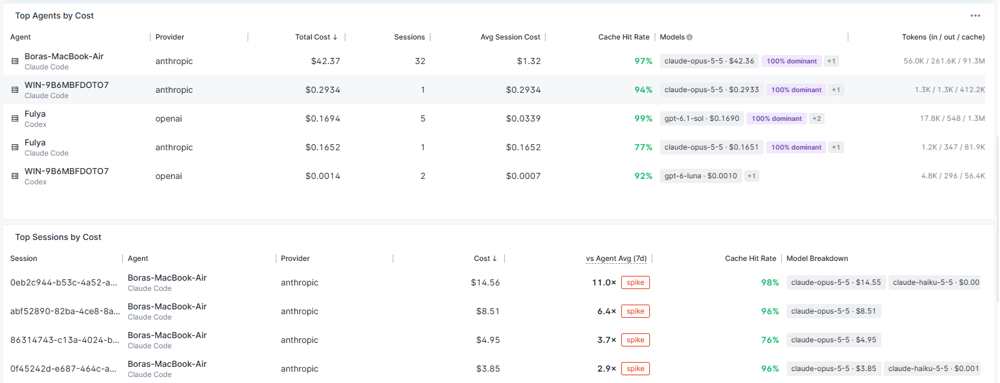
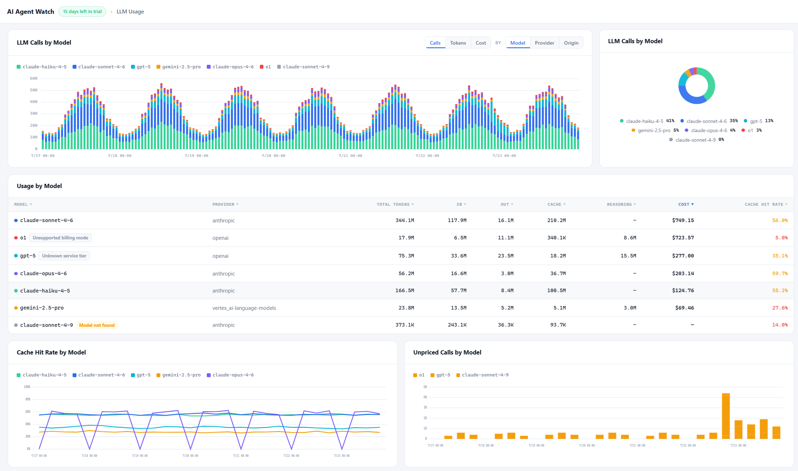
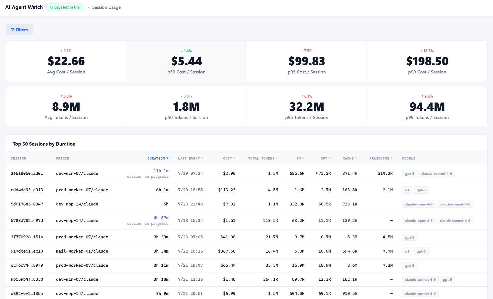
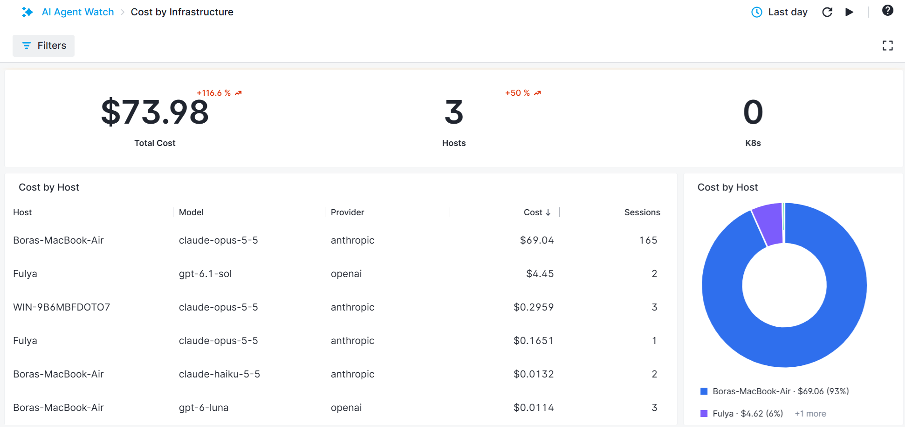
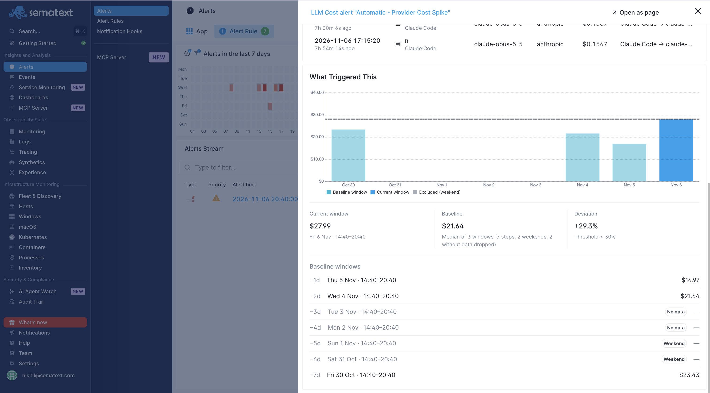

title: Cost Reports
description: Investigate LLM costs by model, agent, session, host, namespace, and cluster

Use **AI Agent Watch → LLM Costs** to understand spending and **Cost by Infrastructure** to locate it across your deployment. Select the Infra Apps and filters relevant to your investigation. Model and provider filters help isolate a particular source of spend.

## LLM Costs

The **LLM Costs** report helps you understand how much your agents are spending and what is driving that spend. See your total cost for the selected period, your recent daily average, and an estimate of monthly spending based on the last seven days.

Use **Cost by Model** to see which models account for most of your spending and whether that mix has changed. The cost heatmap highlights busy and expensive hours over the last seven days, helping you spot recurring patterns or an unexpected burst of activity.

**Top Agents by Cost** helps you compare agents across your organization. Look at session counts, average session cost, and token usage to understand whether an agent costs more because it is doing more work or because its individual sessions are more expensive. **Top Sessions by Cost** lets you follow up on unusually costly sessions and compare them with that agent's usual spending.

Cache hit rates show how much input is being reused from cache. Comparing cache reuse alongside model choices and token usage can help explain differences in cost. Recent cost alerts draw your attention to unusual spending or changes in usage so you know where to investigate next.

## LLM Usage

The **LLM Usage** report helps you understand which models your agents rely on and how that usage changes over time. Switch between calls, tokens, and cost to see whether a model is used frequently, handles large amounts of context, or accounts for a large share of spending.

**Usage by Model** brings token usage and calculated costs together so you can compare models alongside their cache hit rates. Input, output, cache, and reasoning token columns help explain how each model is being used.

Use **Cache Hit Rate by Model** to spot changes in cache reuse, and **Unpriced Calls by Model** to find usage whose cost could not be calculated. Pricing-status labels help you identify missing model prices, unrecognized service tiers, or unsupported billing modes. See [Pricing and Calculations](pricing.md) for details.

## Session Usage

The **Session Usage** report helps you understand what a typical agent session costs, how many tokens it uses, and which sessions stand out. Compare the average with the median (p50) to see whether a few expensive or token-heavy sessions are pulling the average up. The p95 and p99 values show the higher end of session costs and token usage, helping you understand how large those outliers can be.

**Top 50 Sessions by Duration** helps you find long-running sessions and compare their duration with cost, token usage, and models used. In-progress labels and the last-event time help you see which sessions are still running and how recently they produced activity.

## Cost by Infrastructure

The **Cost by Infrastructure** report helps you understand where AI spending is concentrated across your organization. Use **Cost by Host** to compare employee workstations and servers outside Kubernetes and identify which machines account for the largest share of spending.

For Kubernetes workloads, **Cost by Namespace** helps you find the namespaces driving costs, while **Cost by Cluster** shows how spending is distributed across clusters. These views help you see whether an increase is concentrated in one part of your infrastructure or spread across several workloads.

Once you find an expensive host or workload, look at its agents, providers, and models to understand what is driving the cost. Use the context menus to open the related activity and continue your investigation.

## Investigate a spike

Start with the model timeline or cost heatmap, narrow the period, then compare Top Agents and Top Sessions. Follow the expensive origin into its usage events. Check whether a change in session count, model choice, token volume, or cache reuse explains the increase. If an alert fired, open it to inspect its condition and contributing events; see [Cost Alerts](../cost-alert-rules.md#investigate-a-cost-alert).

## Interpret missing or incomplete costs

A missing cost is not the same as zero usage. Requests can report tokens without an applicable model price or supported billing mode. A session with some unpriced calls has a partial cost. See [Pricing and Calculations](pricing.md) for supported service tiers and billing models.
