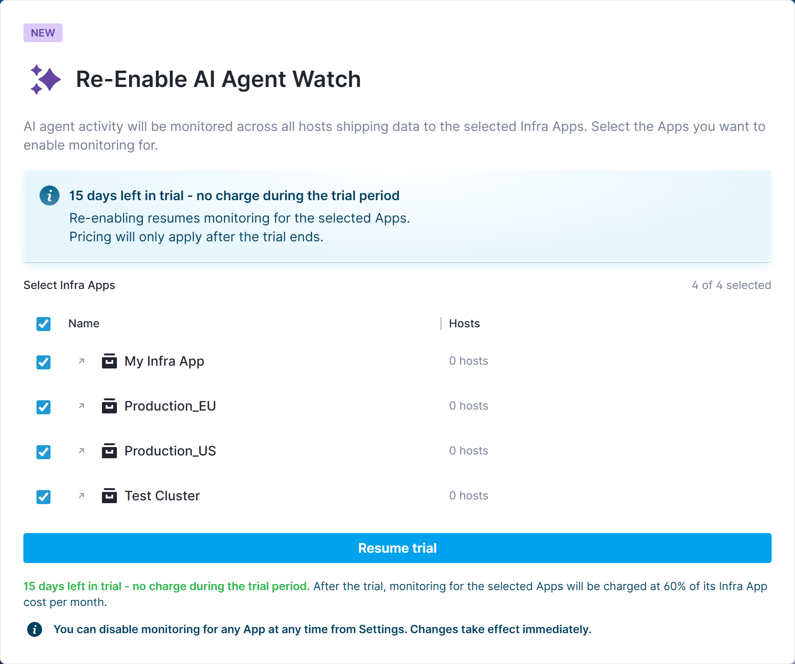
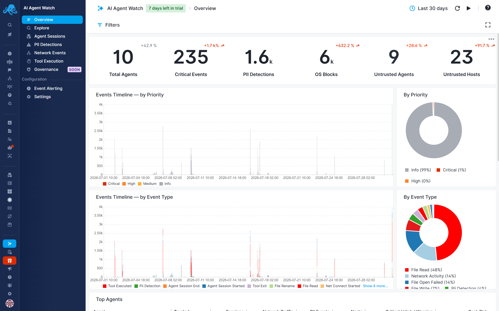

title: Getting Started with AI Agent Watch
description: How to enable AI Agent Watch on an App and start sending AI agent activity to Sematext Cloud

## Enabling AI Agent Watch

AI Agent Watch is enabled on a per-[Infra App](/docs/monitoring/infrastructure/) basis.

If you don't already have an Infra App, [create one first](/docs/monitoring/infrastructure/#create-an-infra-app). Then open the **AI Agent Watch** page, click **Enable**, and select the Infra App(s) for which you want to enable AI Agent Watch.

Enabling AI Agent Watch adds default [PII categories](pii-categories.md), [alert rules](alert-rules.md), and [governance policies](governance/policies.md), and gives you access to built-in [activity and security reports](reports.md) and [cost tracking](cost-tracking/index.md). Governance policies are disabled by default; review and enable them when you’re ready to enforce restrictions.

## Connect servers or workstations

Install or upgrade [Sematext Agent](/docs/agents/sematext-agent/) on each machine with your [Infra App token](#find-your-infra-app-token). Workstations can run Linux, macOS, or Windows; choose the setup path by operating system. See [Platform Support](platform-support.md) for requirements and capability differences.

- **Linux servers and workstations:** Follow [Linux installation](/docs/agents/sematext-agent/linux-installation/). On supported hosts, Sematext Agent automatically discovers AI agents.
- **macOS and Windows:** Use Sematext Agent **4.7 or later**, then configure **Claude Code or Codex** to send telemetry and run hooks. Follow [macOS and Windows Setup](macos-windows.md).

    > AI Agent Watch currently supports only Claude Code and Codex on macOS and Windows.

### Find your Infra App token

1. In Sematext Cloud, open **Fleet & Discovery → Agents → Install Agent**.
2. Select the Infra App you enabled for AI Agent Watch. If you need a new one, [create an Infra App](/docs/monitoring/infrastructure/#create-an-infra-app) first.
3. Select the operating system or deployment environment for your machine.
4. Copy the token from the installation instructions. On macOS and Windows, it appears under **Infra App Token**; other environments include it in their installation commands or configuration.

Use this token when installing or configuring Sematext Agent so the machine sends data to the intended Infra App.

> **Screenshot placeholder — Find your Infra App token:** Show the Install Agent screen, the selected Infra App and environment, and where the token appears. Replace the token with a sample value.

## Verifying data is flowing

After completing the setup, open the AI Agent Watch Overview screen for the App. You should see [captured events](captured-events.md) - starting with an `agent_session_started` event - within a few minutes.

## No AI Agents Detected Yet

[Sematext Agent](/docs/agents/sematext-agent) continuously discovers AI agents on supported Linux hosts and automatically begins monitoring their activity. If none are running, no AI agent data will appear. On macOS and Windows, start a configured Claude Code or Codex session and use the [workstation verification steps](macos-windows.md#verify) to check telemetry and hooks.

This is expected—and valuable. Leaving Sematext Agent running provides continuous visibility into your environment and gives you immediate awareness when new AI agents are introduced, whether intentionally or without authorization. Early detection helps identify potentially malicious, misconfigured, or high-risk AI agents before they become a security or compliance concern.

For the best coverage and strongest security posture, deploy Sematext Agent on as many hosts as possible. The broader your deployment, the greater the likelihood of discovering AI agents wherever they appear across your infrastructure.

## Next steps

- Check [Platform Support](platform-support.md) for available capabilities
- Explore [Cost Tracking](cost-tracking/index.md) and configure [cost alerts](cost-alert-rules.md)
- Review the [captured events](captured-events.md) AI Agent Watch records
- Mark known agents and destinations as [trusted](trusted-agents-hosts.md) to tune alerting
- Review or customize the default [PII categories](pii-categories.md) and [alert rules](alert-rules.md)

- Review the default [governance policies](governance/policies.md) or create your own, define their conditions and scope, and enable them on [compatible hosts](governance/compatibility.md) to block the operations you want to restrict.
