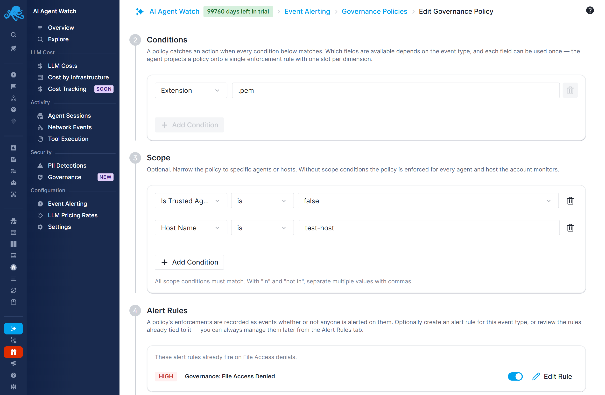

title: Strict Policies for Newly Discovered Agents
description: Automatically apply governance restrictions to untrusted AI agents and review them before granting trust

You can apply a set of governance restrictions to newly discovered AI agents automatically. Scope your policies to **Is Trusted Agent is false**: new agents start untrusted, so the restrictions apply without adding each agent to a policy individually.

For example, an organization can restrict unreviewed agents from accessing credential files, running selected commands, or connecting to private networks. After reviewing an agent, an administrator can mark it trusted to remove it from these untrusted-only policies. Policies with other matching scopes continue to apply.

The workflow below establishes automatic restrictions for untrusted agents using the operations you explicitly choose to block.

## 1. Prepare a host and define the restrictions

Follow [Governance Compatibility](compatibility.md) to confirm that enforcement is available on the target machine. For macOS and Windows, complete the [coding-agent hook setup](../macos-windows.md).

Decide what an unreviewed agent should be prevented from doing. Start with a specific test host so you can verify the effect before applying the restrictions more broadly.

The following are examples of separate policies. Adapt them to your environment:

| Policy type | Condition | Scope | Intended restriction |
|---|---|---|---|
| File Access | Extension ends with `.pem` | Is Trusted Agent is false | Block access to files with this credential-file suffix. |
| File Access | Extension ends with `.env` | Is Trusted Agent is false | Block access to files with this environment-file suffix. |
| Tool Execution | Binary basename `nc` | Is Trusted Agent is false | Block execution of the netcat binary with this name. |
| Network Activity | CIDR `10.0.0.0/8` | Is Trusted Agent is false | Block matching connections to this private IPv4 range. |

See [Platform Support](../platform-support.md#capability-comparison) before choosing conditions.

## 2. Create and enable the policies

1. Open **AI Agent Watch → Event Alerting → Governance Policies**.
2. Click **Add Policy** and choose the policy type for one restriction.
3. Name the policy and add its condition, using the examples above or your own targets.
4. In **Scope**, select **Is Trusted Agent**, operator **is**, value **false**. For a test deployment, also add **Host Name is** your test host.
5. Save and enable the policy. Repeat for the other restrictions.
6. Optionally configure [alert rules and notifications](policies.md#get-notified-when-a-policy-matches) for the resulting governance events.

Each policy controls one action type. Create separate policies for file access, tool execution, and network activity. Additional scope entries are combined with AND, so a test-host scope restricts enforcement to untrusted agents on that host.

Policies must be enabled to enforce anything. The provided [default example policies](policies.md#default-example-policies) are disabled until you enable them; add the untrusted-agent scope before using them for this workflow.

## 3. Verify the restrictions

Allow policy changes to reach Sematext Agent; updates can take up to five minutes. On macOS and Windows, also run `st-agent ai-agent-watch check` to verify the hooks.

1. Start an untrusted AI agent on the test machine.
2. Ask it to perform an operation matching one test policy. For example, use a harmless test file ending in `.pem` and ask the agent to read it. On macOS or Windows, use a supported file-reading tool rather than assuming a shell command provides the same coverage.
3. Confirm that the operation is refused. In **AI Agent Watch → Governance**, find the corresponding `file_access_denied`, `exec_denied`, or `net_denied` event and inspect the agent, host, and matched condition.
4. Verify the other policy types you plan to use. An allowed action alone does not prove enforcement is working.

When you are satisfied, remove the test-host scope or replace it with the hosts or workloads you want to protect. Keep **Is Trusted Agent is false** on every policy intended for this workflow.

## What this workflow does and does not provide

| Requirement | Current behavior |
|---|---|
| Automatically restrict newly discovered, untrusted agents | Enabled policies with Is Trusted Agent is false apply to matching agents as they are discovered and policy configuration reaches the host. |
| Exempt a reviewed agent from those restrictions | Mark it trusted; untrusted-only policies stop applying after the update reaches the host. |
| Block everything except specific paths, commands, or destinations | No general allowlist or allow-override mode is available. Define explicit blocking conditions instead. |
| Use Trusted Hosts as governance exceptions | Trust affects event classification and alerting; it does not override network governance policies. |
| Guarantee a sandbox across all platforms | Enforcement is limited to each platform's supported operations and collection mechanism. |

For shorter answers, see the [AI Agent Watch FAQ](../faq.md). For the full policy grammar, see [Governance Policies](policies.md).
