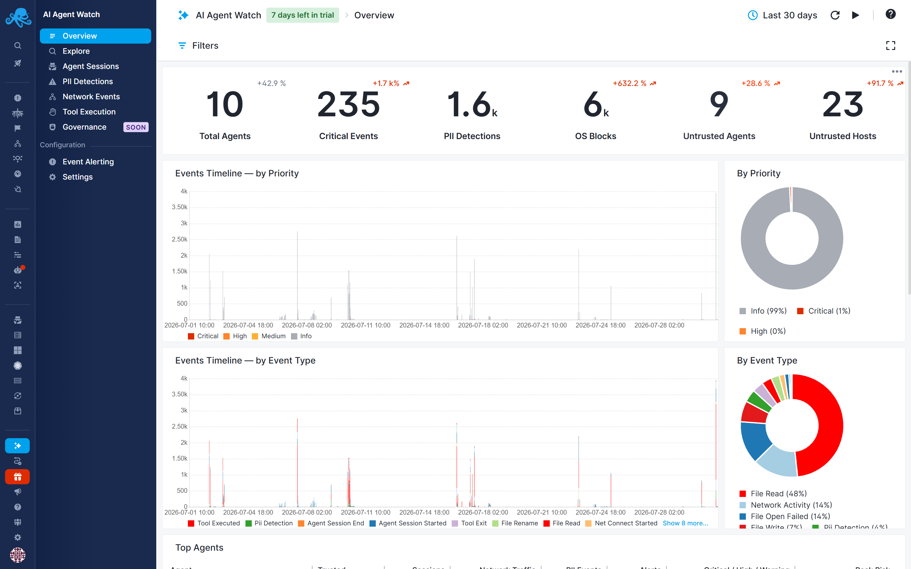
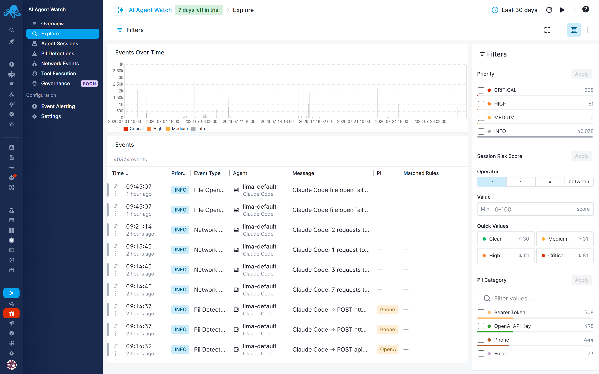

title: AI Agent Watch
description: Understand AI agent activity, manage security risks, and track AI spending across company servers and employee workstations

AI agents - coding assistants, autonomous scripts, and agentic workflows - execute commands, access files, and interact with external services on your behalf. AI Agent Watch helps you understand what they are doing, catch risky behavior, apply governance policies, and see which agents, sessions, and models drive AI spending.

Review AI activity across company servers and employee workstations in one place, from an organization's deployed workloads to the coding agents its employees use every day.

## Why use it

- **See what your agents actually do.** Investigate sessions, tool executions, file activity, and outbound connections in [reports](reports.md), with visibility into the activity available from each supported platform.
- **Catch risky behavior.** Get notified about unexpected activity, such as credential access or connections to unfamiliar destinations, using [alert rules](alert-rules.md).
- **Protect sensitive information.** Detect credentials, API keys, and personal data in captured content with [PII categories](pii-categories.md).
- **Control agent actions.** Use [governance policies](governance/index.md) to block supported operations that violate your security requirements.
- **Understand AI spending.** Compare token usage and calculated costs across agents, sessions, models, and infrastructure with [Cost Tracking](cost-tracking/index.md).
- **Focus your investigations.** Use [risk scores](risk-scores.md) to identify sessions that deserve attention and [trusted agents and hosts](trusted-agents-hosts.md) to distinguish expected activity from unfamiliar agents and destinations.

## Servers and employee workstations

On company infrastructure, AI Agent Watch helps you discover AI agents, investigate their activity, audit security events, and understand the cost of agent-driven workloads. Detecting newly introduced agents gives you an opportunity to review unexpected or unauthorized AI use.

On employee workstations, it brings visibility to everyday AI-assisted development. Review coding-agent sessions and tool activity, identify sensitive-data exposure, apply governance, and understand how employees' agents use models and tokens.

Together, these views help you manage AI use across your organization as it expands from shared infrastructure to individual development machines.

## Understand AI spending across your organization

Which agents spend the most? Which models drive the bill? Was a cost spike caused by one expensive session or a wider increase in activity?

[Cost Tracking](cost-tracking/index.md) helps answer these questions. Compare agents across servers and employee workstations, investigate expensive sessions, and see where model choice and cache reuse affect spending. [Cost alerts](cost-alert-rules.md) help you spot unexpected increases so you can act before they grow.

## Govern AI agent activity

[Governance](governance/index.md) helps you put boundaries around agent actions, such as running commands, accessing sensitive files, or contacting restricted destinations. Review blocked activity and investigate which policies are being triggered across your deployment.

Enforcement capabilities vary by platform. See [Governance](governance/index.md) for supported actions and requirements.

## Get started

Follow [Getting Started](getting-started.md) to connect your servers or workstations and begin reviewing activity.

## In this section

- [Getting Started](getting-started.md) - connect servers and workstations
- [Platform Support](platform-support.md) - supported platforms and capabilities
- [Reports](reports.md) - explore activity and investigate sessions
- [Captured Events](captured-events.md) - available activity and platform coverage
- [Governance](governance/index.md) - policies, enforcement, and requirements
- [Strict Default Policies](governance/strict-default-policies.md) - automatically restrict unreviewed agents
- [FAQ](faq.md) - common questions about trust and governance
- [LLM Cost Tracking](cost-tracking/index.md) - usage, reports, pricing, and cost alerts
- [Trusted Agents & Hosts](trusted-agents-hosts.md) - distinguish expected agents and destinations
- [PII Categories](pii-categories.md) - detect sensitive information
- [Alert Rules](alert-rules.md) - identify risky activity and configure notifications
- [Risk Scores & Priorities](risk-scores.md) - prioritize events and sessions
