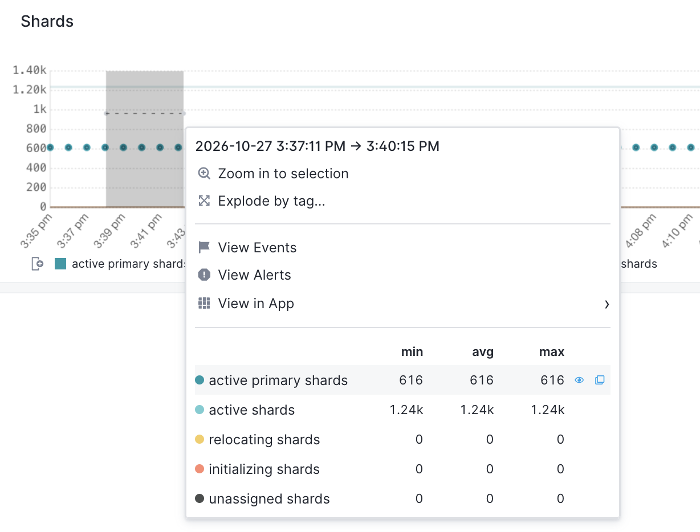
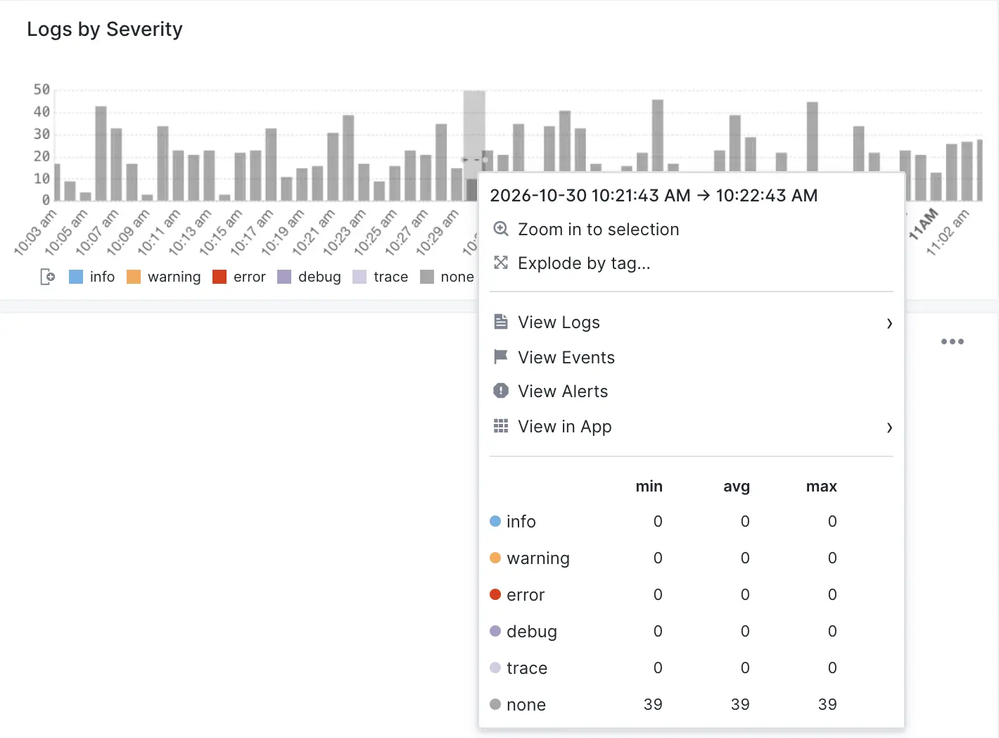
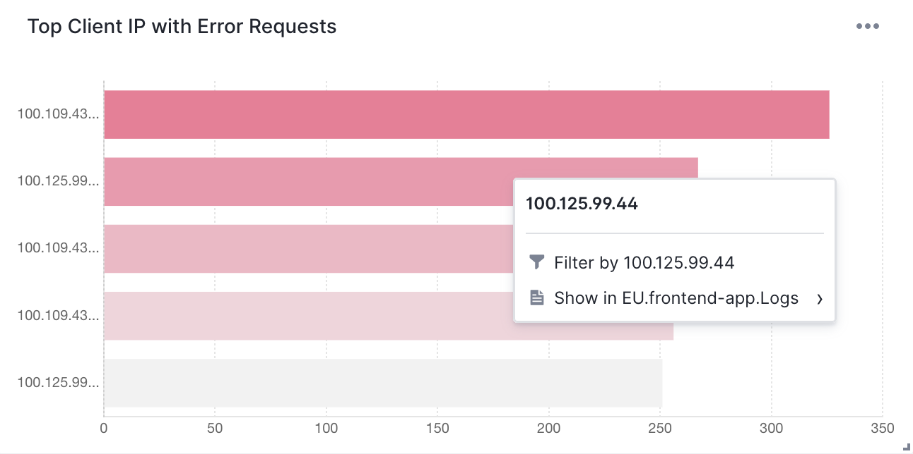
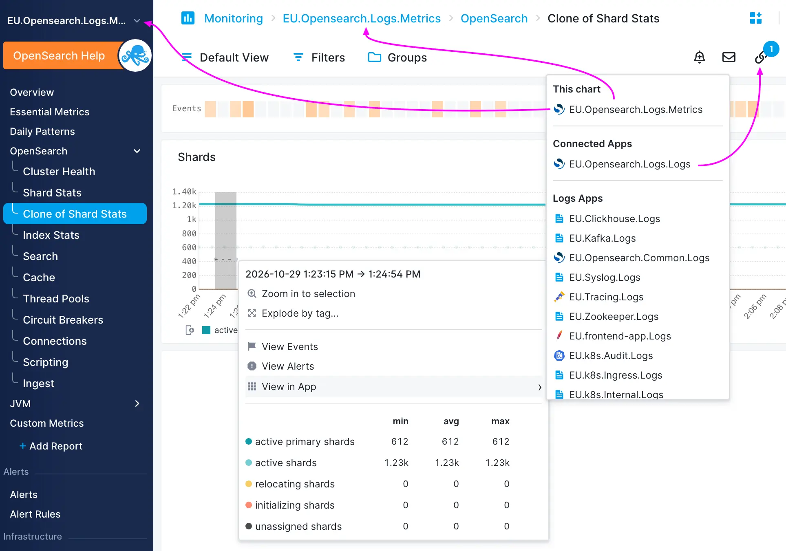
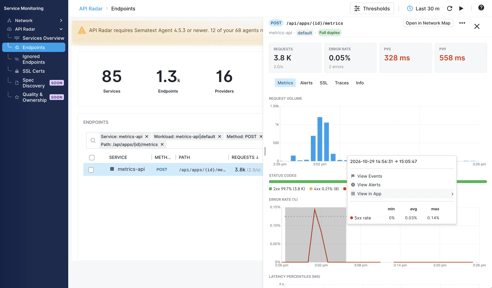

To open a Context Menu simply click and drag on a time-series chart. You can also simply click on individual data points on time-series as well as some non-time series charts.

Here’s an example of the Context Menu. This one is from a time-series chart showing five OpenSearch metrics in a Monitoring App.  

Here is another example from a time-series chart in a Logs App. Here we didn’t actually click and drag on the chart \- **we simply clicked on one of the bars**.

Here is another one for a bar chart, **not a time-series chart**.

### Zooming in

On time-series charts the option to zoom in is at the top because that’s what you most often need.

### Explode by tag

Some Context Menus let you [explode aggregated charts](/docs/dashboards/explode-by-tag/) into a series of charts with a single data series.

### View Events

This shows events from the selected time range in a flyout. Events in this flyout can be searched and filtered, so you can narrow down to only events of interest. If you need to change the time range of the displayed events, you can do that from the flyout. Like all flyouts, this flyout can be expanded and closed.

### View Alerts

Shows the alerts screen where you will see all alerts triggered in the selected time period.

### Pivoting with View in App

Use this to pivot to *other telemetry* and *other signals* in Sematext, so you can more quickly connect the dots when troubleshooting or simply observing your systems.

<video controls>
<source src="/docs/images/dashboards/context-menu-example-video.mp4" type="video/mp4">
</video>

#### This App

The curiously named **This App** entry points to the same App whose data the chart is based on. In other words, if you are looking at the chart in some App called Foo, then the entry under This App will be the App Foo. Something like this:

*App Foo \> App report \> chart \> context menu \> This App entry*

Thus, the “This App” entry points “back” to “App Foo”. You might wonder why, what’s the point. The value of this becomes obvious when you are on [top level Dashboards](/docs/dashboards/), where you can have a report with charts from multiple different Apps. Imagine something like this:

*Dashboards \> Foo Dashboard \> Report Bar \> chart from App Baz \> context menu \> App Baz*

In this case, when you are on the Foo Dashboard \> Report Bar screen and looking at a chart showing some telemetry from App Baz, it is handy to be able to go to the source, to App Baz, for example to see other metrics or logs or … related to whatever was shown on that chart from App Baz.

#### Connected Apps

This section shows any Apps you have explicitly marked as connected. The [Connected Apps](/docs/guide/connected-apps/) are an easy way to speed up your troubleshooting or simply exploration of your data in Sematext.

#### Pivoting to Logs, Tracing, Monitoring, Synthetic, and Experience Apps

The **View in App** entry in the Context Menu lets you jump to all other Apps directly. Pivoting to them preserves the selected date range so you can pin-point issues faster.

Pivoting to logs and traces is valuable because they typically hold answers to performance, (un)availability, and similar issues. For example, in [Service Monitoring](/docs/service-monitoring/) \> [API Radar](/docs/service-monitoring/api-radar/) (see screenshot below) you will find [endpoints](/docs/service-monitoring/api-radar/endpoints/) and their error rates. When your services' APIs are erroring, where can you see their errors? In those services’ logs or traces. And when you want to drill into the root cause? In their logs and traces. So being able to easily go from error rate alerts and charts to logs and traces that hold answers is key.

#### Data series

In addition to letting you pivot to other observability signals you have in Sematext the new Context Menu shows the list of all data series present on the chart. Each data series’ minimal, average, and maximal value in the selected time period is shown. Sorting by min, avg or max will reorder the series in the Context Menu.

Hovering over a data series label emphasizes it in the chart and makes it easier to spot on charts with multiple data series. Clicking on the data series toggles between hiding and showing it on the chart.
