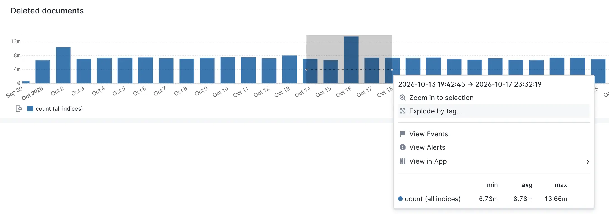
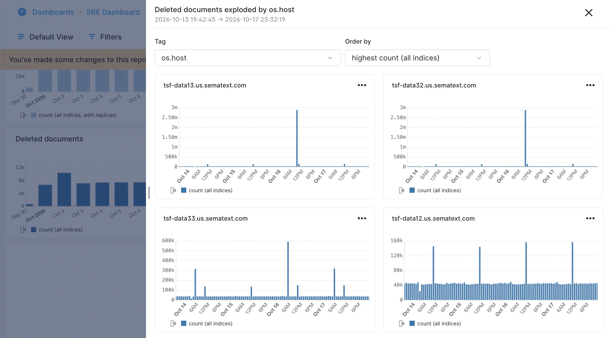
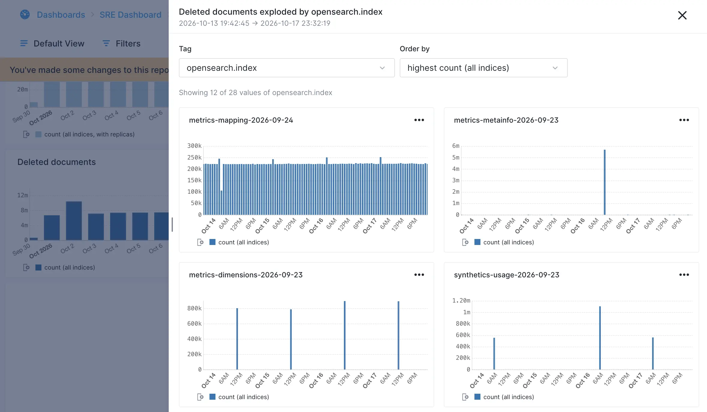
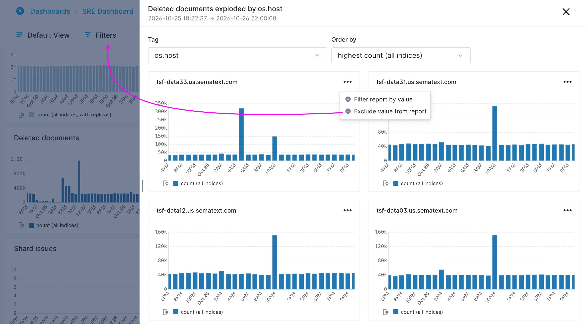

Ever spotted a spike or dip in a time-series chart and wondered what's behind it? Or wanted to compare how different services, hosts, or applications contribute to overall log activity? Or simply wanted to unpack an aggregated metric on a chart?

The **Explode by Tag** functionality, available in Monitoring and Logs Apps, lets you unpack a single  time-series chart into separate charts for each distinct value of a selected tag. In Logs Apps the tags are also referred to as log event fields.

Think of it as a **Split by** rather than the traditional Group by: instead of combining values into groups, Explode by Tag creates a separate time-series chart for each distinct tag value, making it easy to compare their behavior over time.

### How it works

Simply click and drag over the time range you're interested in to open the Context Menu, then select **Explode by tag**. Let’s look at one example.

#### Select what to explode

Suppose you spotted a spike in a chart and want to understand what caused that spike. The chart below shows the number of deleted documents in an OpenSearch cluster.

Selecting Explode by tag will open a flyout and let you choose the tag to split by and how to order the results. Any filters you set will be applied on the data shown in the flyout. Separate charts for the top N distinct values of that tag will dynamically be rendered.

Selecting the spike in the above chart revealed it was two hosts that held the most deleted documents, totalling nearly 6 million documents.

#### Select what to split by

If we change the tag to split by to opensearch.index we discover that an index called metrics-mapping-2026-09-24 had the most deletions and that the deletions are ongoing, while another index called metrics-metainfo-2026-09-23 had a big one-time spike of deletions, and it was that one-time deletion that contributed the most to the spike of deleted documents that started this data exploration.

#### Filter the report

From the flyout you filter the underlying report using each chart’s tag and value as either include or exclude filter. As soon as you include or exclude filters the report will update. The flyout will remain open so you can add more filters or keep exploring.

#### View more charts

The number of charts displayed in the flyout  depends on how many distinct values the selected tag has. Initially, a maximum or 12 charts are displayed, but you can incrementally show more, up to all available values.

### Use cases

Here are a few examples where Explode by Tag can make troubleshooting and analysis easier:

* **Investigate spikes and dips.** See a sudden spike in errors or log volume? Split the chart by service, host, or application to pinpoint what's responsible. The same works for unexpected drops in activity.  
* **Find noisy services and hosts.** Break down log activity by service, host, container, or application to identify which ones generate the most errors, warnings, or other events.  
* **Compare environments and regions.** Split by environment, region, cluster, or availability zone to see whether an issue affects everything or is isolated to a particular part of your infrastructure.  
* **Spot outliers.** Compare individual services, customers, or other entities to find those behaving differently from the rest, even when the overall chart looks normal.  
* **Understand changes in overall activity.** Determine whether a change in log volume or event patterns comes from one dominant tag value or from many values changing simultaneously.

**Explode by Tag** makes it easy to go from an aggregated view to individual time series, helping you understand what's happening beneath the surface without manually creating separate charts or queries.
