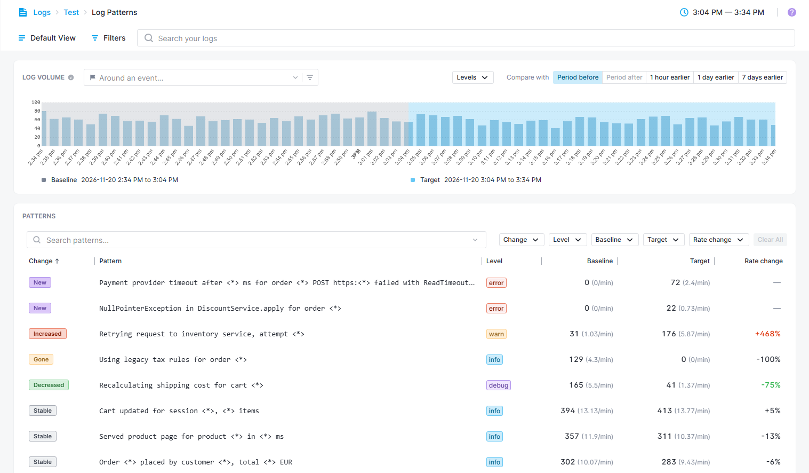
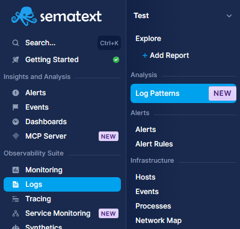
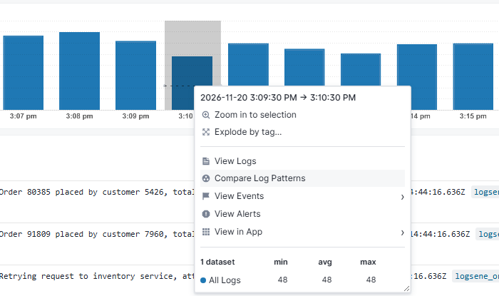
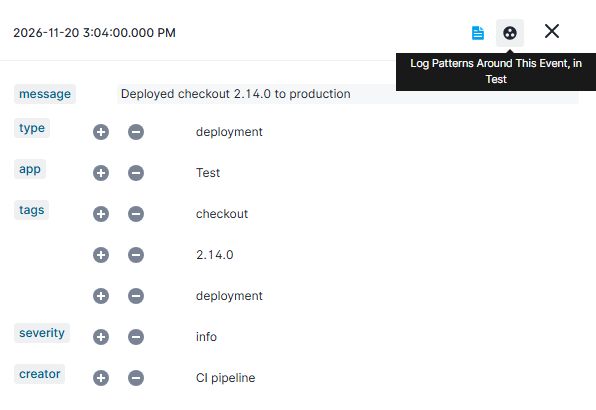
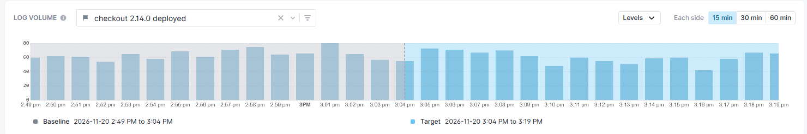
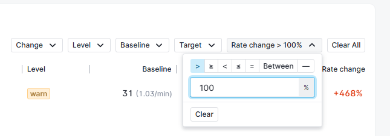
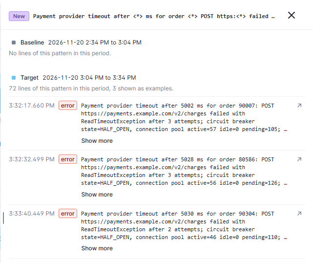
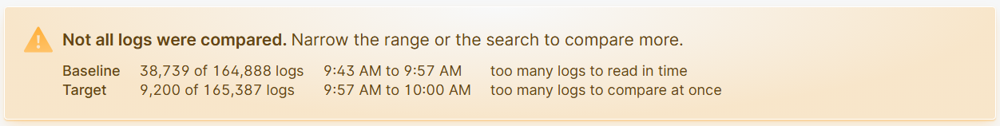

title: Log Patterns
description: Group similar log lines into patterns and compare two periods, for example before and after a deployment, to see which patterns are new, gone, more frequent or less frequent.

A busy application can write thousands of log lines a minute, but most of them are the same few messages with different numbers, IDs and names in them. Log Patterns groups those lines into patterns, so you read a short list instead of thousands of lines.

<div class="compact-example" markdown>

These three lines, for example:

```
Payment declined for order 81723, card expired
Payment declined for order 81731, card expired
Payment declined for order 81902, card expired
```

become one pattern, `Payment declined for order <*>, card expired`, with `<*>` in place of the part that changes.

</div>

Log Patterns compares two periods. The **target** is the time range you are looking at. The **baseline** is a period of the same length that the target is compared with. For each pattern, Log Patterns counts its lines in both periods and shows whether the pattern is new, gone, more frequent or less frequent. Use it to answer questions such as:

- What changed in my logs after this deployment?
- Which messages are behind this spike in log volume?
- Is this error new, or did it happen yesterday as well?



## Opening Log Patterns

### From the Logs App Menu

Open a Logs App and click **Log Patterns** in the **Analysis** section of its menu. The page uses the time range, search and filters you had in the Logs App.



### From a Chart

In a Logs App report or on a dashboard, drag across a chart of logs or click one of its bars. This opens the [Context Menu](/docs/dashboards/context-menu/). Click **Compare Log Patterns**, and the selected range becomes the target. The comparison uses the chart's filters, so it covers the same logs as the chart. If the chart has several data series, or shows logs from several Logs Apps, pick one from the submenu.



### From an Event

In the [Events](/docs/events/timeline/) table, click an event, such as a deployment. At the top of its details panel, click the **Log Patterns Around This Event** icon. Log Patterns opens in a new tab and compares the 15 minutes before the event with the 15 minutes after it.

The icon is there only when the event belongs to a Logs App, or to an App with a [connected](/docs/guide/connected-apps/) Logs App. If several Logs Apps are connected, clicking the icon lets you pick one.



## Choosing What to Compare

The target is the time range in the time picker at the top of the page, and the baseline is always just as long. The **Log volume** chart shows both periods and highlights the target. To compare a different range, drag across the chart or pick another one in the time picker.

Use **Compare with** to pick the baseline:

| Compare with | Baseline | Use it to |
|---|---|---|
| **Period before** (default) | The period right before the target | See what changed when the target began, for example after a deployment or at the start of an incident. |
| **Period after** | The period right after the target | Compare the target with what came after it, for example an incident with the time after the fix. |
| **1 hour earlier** | The same range, one hour earlier | Compare with a time before the problem, if it started a while ago. |
| **1 day earlier** | The same time of day, one day earlier | Check if a change is real or if it happens at this time every day. |
| **7 days earlier** | The same time, one week earlier | Check if a change is real or if it happens at this time every week, for example because of a weekly job. |

The **Change** labels in the table always describe the target compared with the baseline. So with **Period after**, a pattern marked **New** has lines in the target but none in the period after it.

A choice is grayed out when its baseline would overlap the target, or has not ended yet. For example, **1 day earlier** works only for ranges of 1 day or less, and **Period after** only once the period after the target has ended. Hover over a grayed-out choice to see why.

### Around an Event

To compare the time before an event with the time after it, pick the event in **Around an event...** above the chart. The list shows deployments first, then other [events](/docs/events/). Type to search the list, or click its filter icon to narrow it down by event type, App and time.

When you pick an event, the target becomes the time right after it, and the baseline the same amount of time right before it. **Each side** sets how long both periods are: 15 minutes (the default), 30 or 60 minutes. A line on the **Log volume** chart marks the event. To go back to **Compare with**, clear the event.



## Narrowing Down the Logs

In both periods, Log Patterns compares only the logs that match the search and filters at the top of the page. The search and filters work as in a Logs App report. See [Search Syntax](/docs/logs/search-syntax/) and [Fields](/docs/logs/fields/).

Use **Levels** to compare only some log levels, for example errors and warnings. It lists the levels found in the logs you are comparing. Each level you pick is added as a filter, so you also see it in the filter bar. Levels come from the `severity`, `level`, `levelname` or `status` field. If your logs have none of these fields, the list is empty.

Picking fewer levels also means fewer logs to read. On a busy App, Log Patterns can then compare more of each period. See [When Not All Logs Are Compared](#when-not-all-logs-are-compared).

## Reading the Patterns Table

Each row of the **Patterns** table is one pattern.

| Column | What it shows |
|---|---|
| **Change** | How the pattern changed from the baseline to the target. See the labels below. |
| **Pattern** | The text of the pattern. `<*>` stands for the parts that change. |
| **Level** | The log level of the pattern's lines. The same message logged at two levels makes two patterns. |
| **Baseline** | How many lines of the pattern are in the baseline, in total and per minute. |
| **Target** | The same for the target. |
| **Rate change** | How much the pattern's lines per minute went up or down from the baseline to the target, in percent. A dash (—) means the pattern has no lines in the baseline to compare with. |

The **Change** column uses these labels:

| Label | Meaning |
|---|---|
| **New** | No lines in the baseline, and at least 3 in the target. |
| **Increased** | A rate change of +50% or more, with at least 5 lines in the target. |
| **Gone** | No lines in the target, and at least 3 in the baseline. |
| **Decreased** | A rate change of -33% or less, with at least 5 lines in the baseline. |
| **Stable** | Any other pattern. |

A pattern with only a line or two stays **Stable**, so that a few stray lines don't count as a change. The table lists new patterns first, then increased, gone, decreased and stable ones. Click a column header to sort by it.

If the two periods have more than 1,000 patterns, the table shows the first 1,000, starting with the new ones, and says how many there are in total. Narrow the search to see the rest.

### Filtering the Table

Above the table, type in **Search patterns…** to find patterns by their text. Five filters narrow down the rows:

- **Change** and **Level**: pick one or more values. Next to each value is the number of patterns that have it.
- **Baseline** and **Target**: type a number to show only the patterns with more than, at least, less than, at most or exactly that many lines. Switch to **Per minute** to compare lines per minute instead, or pick **Between** to give a range.
- **Rate change**: the same comparisons, in percent. Pick **—** to show only the patterns with no lines in the baseline.

**Clear All** removes all five filters. These filters only hide rows. They don't change which logs are compared. For that, use the search, the filters and **Levels** at the top of the page.



## Viewing the Lines of a Pattern

Click a pattern to open its details in a side panel. For the baseline and the target, the panel shows how many lines the pattern has and up to three of them as examples, with their time and level. Click **Show more** under a long line to see all of it.

To see what happened around a line, click the **Open in Logs** icon next to it. The [Context View](/docs/logs/context-view/) opens in a new tab and shows the line together with the logs right before and after it.



## When Not All Logs Are Compared

Log Patterns reads the logs of both periods before it compares them. When it can't read all the logs of a period, it compares the ones it did read and shows a warning above the chart. For each period that was cut short, the warning shows how many of its logs were read and which part of the period they come from. It also says why reading stopped:

- **too many logs to read in time**: the period has more logs than can be read in a few seconds.
- **too many logs to compare at once**: comparing many or very large logs takes a lot of memory, so Log Patterns stops reading once a comparison gets too big.
- **older logs not kept**: part of the period is older than your App's data retention, so those logs are no longer stored.

With **Period before**, **Period after** and around an event, the two periods are next to each other, so Log Patterns reads each of them starting from the moment they meet. So if a period is cut short, the logs compared are the ones closest to that moment, such as right before and right after a deployment. When the periods are apart, both are read backward from their end, so the most recent logs of each period are compared.

Rates per minute count only the time that was read, so a period that was cut short still compares fairly with the other one.

To compare more of your logs:

- pick a shorter time range
- narrow the search or the filters, for example to one service or host
- pick only the levels you need in **Levels**, such as errors and warnings



A note above the table also tells you when a period has no logs, or too few logs for a fair comparison. If not all of the target has passed yet, for example right after a deployment, it is compared up to the moment the comparison ran. Click **Compare again** to include the logs that came in since.

## If the Comparison Fails

| Message | What to do |
|---|---|
| The search could not be read | Check the search for a typo, such as a missing quote or bracket. |
| The comparison took too long | Pick a shorter time range or narrow the search. |
| Too many comparisons are running | Try again in a few seconds. |
| This Logs App has no logs yet | Patterns show up once the App receives logs. |

When trying again can help, the message has a **Compare again** button.

## How Patterns Are Found

Log Patterns looks only at the `message` field of your logs. Lines go into the same pattern when their messages differ only in things like numbers, IDs, IP addresses, URLs, paths, or a word that changes from line to line. A few rules keep lines apart:

- Lines with different log levels always go into separate patterns.
- HTTP status codes, such as `status=500`, and error names, such as `TimeoutException`, are never replaced by `<*>`. Lines with different codes or errors go into separate patterns.
- Some words take only a few values, such as `processed` and `declined` after `Payment`. Each value can get its own pattern, so a rise in declined payments isn't hidden among the processed ones.

Messages longer than 4 KB are left out of the patterns.
