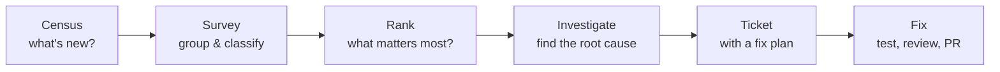

title: Autofixer
description: Autofixer is an agent skill that finds bugs in your code using the logs, traces and other telemetry you send to Sematext Cloud, files a ticket for each one worth fixing, and fixes them

Every production system logs errors, and most of them don't matter: a client sent bad input, the network blipped, a dependency restarted and the code recovered. Somewhere in that pile are real bugs in your code, but going through it takes hours nobody has, so they sit there for weeks or months.

Autofixer does that work for you. It reads your production telemetry in Sematext Cloud, separates real bugs from noise, finds the root cause of each bug in your source code, decides whether it's worth fixing, and then files a ticket or opens a pull request with the fix.

## What is Autofixer

Autofixer (AF for short) is an **agent skill**: a set of instructions, written in plain Markdown, that your AI coding agent follows. It isn't a service you sign up for or a bot running somewhere. Your coding agent (Claude Code, Codex, or any other agent that loads [Agent Skills](https://agentskills.io)) does the work, on your machine, with the access you give it. Autofixer tells it how to do the job well and how your team wants it done.

It works in three steps:

1. **Find** issues on its own, in your logs, traces and other observability data.
2. **Pinpoint** the root cause in your source code, using clues from that data.
3. **Fix** them: it files a ticket for each confirmed issue worth fixing, with everything a fix needs, and fixes a ticket when you ask.

What Autofixer is **not**:

- It doesn't change anything in production. Its access to your Sematext Cloud account is read-only.
- It doesn't merge code. It can open pull requests, but a person always reviews and merges them.
- It doesn't file a ticket for every error it sees. Most errors turn out to be noise, and many real bugs aren't worth the cost of fixing them. Autofixer is built to tell these apart.

## How it works

### From a log line to a pull request

A **run** goes through the first five steps. It counts what's new in each part of your system, groups errors into distinct problems, ranks them by how much they hurt your users, investigates the top ones in your code, and files a ticket for each confirmed bug worth fixing.

A **fix** is the last step. You ask Autofixer to fix a ticket, and it does so in a session of its own: it writes a failing test first, makes the fix, gets the change reviewed, and opens a pull request.

### Lanes: one service at a time

Autofixer splits your system into **lanes**, usually one per significant service or a small group of tightly coupled services. Each lane is surveyed on its own, so one noisy service can't bury the errors of a quiet one.

Each lane has a file that records every decision made about that service's errors: what's noise, what was looked at and dropped, which bugs already have tickets. That file is how Autofixer remembers what it already knows.

### Signatures and matches

Thousands of log lines usually come from a handful of problems. Autofixer groups them by **signature**: the error message with the IDs, numbers, timestamps and hostnames taken out. `Timeout after 3021 ms calling orders-7f9c` and `Timeout after 5004 ms calling orders-2b1d` are the same signature.

For each signature, Autofixer writes a **match**: a Sematext Logs query that selects exactly that signature's lines. Matches let it count a problem over any time range, and they let it filter out problems it has already classified.

### The residual: only looking at what's new

A lane's **residual** is every error in that lane that doesn't match anything Autofixer has already classified. This is what each run starts from.

The first run on a lane sees everything as new, so it does the most work. Every later run only looks at what has appeared since, which is usually little. This is why Autofixer gets cheaper and faster the more you use it.

### Deciding what's worth fixing

Not every real bug is worth fixing. For each confirmed bug Autofixer estimates, from real counts rather than guesses:

- **Frequency**: how often it happens, per week and per month.
- **Blast radius**: what each occurrence breaks or loses.
- **Consequence**: what a user actually sees, from wrong data or a missed alert down to nothing at all.
- **Cost**: what the fix takes, from a small change in one service to a database migration or a manual step in production.

A bug with low impact and a costly fix becomes a **known issue**: it's recorded, with the numbers and a condition for looking at it again ("revisit if it happens more than 100 times a week"), but no ticket is filed. Everything else gets a ticket. You can always ask Autofixer to file a known issue anyway.

Autofixer checks the value again right before it fixes a ticket, because things change between the run that filed it and the day someone picks it up.

## What you need

### An AI coding agent

Any coding agent that loads [Agent Skills](https://agentskills.io) and can read files and run shell commands. Autofixer itself is a folder of Markdown files you clone into your agent's skills directory.

### The Sematext Cloud MCP Server

Autofixer reads your telemetry through the [Sematext Cloud MCP Server](/docs/mcp/). It needs a Sematext Cloud account that receives your application's logs at least. The more you send, the more it can find:

| Data | What it gives Autofixer |
|---|---|
| Logs, with a severity field and a field naming the service | The errors it surveys, split into lanes |
| Traces (OpenTelemetry) | Slow endpoints, 5xx responses and the request path behind an error |
| Deployment events that carry the commit or version | Narrowing a new error down to the deploy that introduced it |
| Infrastructure monitoring (the Sematext Agent) | Restarts, out-of-memory kills and node drains around an error |
| Synthetic monitors on the endpoints users depend on | Failures your users would see first |

During setup, Autofixer tells you what's missing and how to ship it.

### Your code repositories

Autofixer reads your code to find root causes and changes it to fix them, so the repositories need to be checked out on the machine where your agent runs.

### An issue tracker and a code host (optional)

With an issue tracker such as Jira and a code host such as GitHub, Autofixer files real tickets and opens real pull requests. Without them, it writes tickets as Markdown files in your repository and leaves fixes on local branches.

## Modes

You talk to Autofixer in plain words. There are four things you can ask it to do:

| Mode | You say | What happens |
|---|---|---|
| Setup | "Set up Autofixer" | Once per repository. Autofixer studies your telemetry and code, asks you a few questions, and writes its notes into the repository. See [Setting up Autofixer](setup.md). |
| Run | "Run Autofixer" | Finds and investigates candidates, and files a ticket for each confirmed bug worth fixing. See [Running Autofixer](using.md#running-autofixer). |
| Fix | "Fix PROJ-123" | Fixes one ticket: re-checks it, writes a failing test, fixes the code, reviews the change and opens a pull request. See [Fixing a ticket](using.md#fixing-a-ticket). |
| File | "File the known issue …" | Files a ticket for a known issue that a run held back. See [Filing a known issue](using.md#filing-a-known-issue). |

## How much Autofixer does on its own

You decide how far Autofixer goes, separately for runs and for fixes, when you set it up.

### Run autonomy: report only, or file tickets

With **report only**, a run ends with a report of what it found and you decide what to file. With **tickets**, it files them directly. The run report lists every ticket it filed, so you can review them afterwards.

### Fix autonomy: branch, commit or pull request

A fix can stop at a **local branch**, at a **commit**, or go all the way to an **open pull request** assigned to you.

### What always stays with a person

- Merging pull requests.
- Decisions Autofixer shouldn't make on its own, such as security trade-offs, priorities, or problems in another team's code or in your infrastructure. These go into the run report under **Needs engineer review**, with enough detail to act on.

Once its initial checks pass, a run or a fix doesn't stop to ask questions. Anything that needs a person goes into the report instead, so you can start a run and come back to the results.

## Safety and privacy

### Read-only access to your observability data

Autofixer only reads logs, traces, metrics and events through the MCP Server, which itself has read-only access. It never acts on your Sematext Cloud account.

### No secrets, anywhere

Autofixer never writes an API key, token, password or webhook URL into a file, ticket, pull request or commit.

### Customer identifiers stay out of code and pull requests

Files Autofixer commits to your repository, its commits and its pull requests never contain identifiers of your users or customers, such as emails, names or account IDs. They describe them instead ("one customer's App"). Whether tickets in your tracker may carry such identifiers, which can help confirm an issue in a customer's account, is your choice, made during setup.

## Next steps

- [Set up Autofixer](setup.md) for your repository.
- Learn how to [run it, fix tickets and review its work](using.md).
- See what Autofixer keeps in [the `_autofixer` folder](autofixer-folder.md).
- Read the [FAQ](faq.md).
