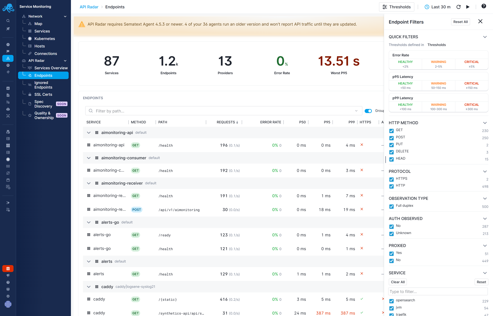
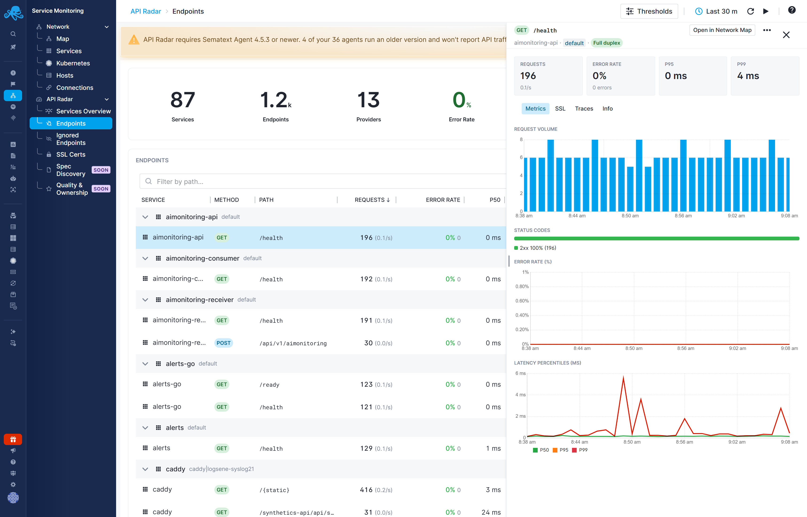

title: Endpoints
description: Filter discovered API endpoints and inspect request metrics, coverage, and network context

Open **Service Monitoring → API Radar → Endpoints** to browse observed API operations. Each row identifies a service, HTTP method, and path.

<!-- Release check: confirm normalization and endpoint identity rules, including provider/authority and deployment dimensions. -->

## Read the endpoint table

| Field | Meaning |
|---|---|
| Service, Method, Path | The service and API operation represented by the row. |
| Requests | Observed request count and request rate in the selected range. |
| Error Rate | Server error percentage, shown alongside the observed 5xx count when available. Inspect status codes separately for 4xx responses. |
| p50, p95, p99 | Response-time percentiles. p95 is the value at or below which 95% of measured response times fall. |
| HTTPS | Whether HTTPS was observed for the endpoint. |
| Auth | Whether an authentication header was observed; this is not a test of authentication enforcement. |
| Internal | A [manually applied classification](#internal-endpoints) used to exclude endpoints from alert rules. |
| Observation | Whether both requests and responses, or only outbound requests, were observed. |

## Filter and group

Use **Filter by path** to narrow the list and **Group by service** to organize operations under their service. Open **Filters** for facets such as observation status, HTTPS, observed authentication, and service or provider. Metric quick filters use the configured [thresholds](thresholds-alerts.md).

Use column sorting to find high-volume, slow, or failing operations.

## Observation coverage

- **Full Duplex** - both request and response activity were observed.
- **Egress Only** - request activity was observed without the corresponding response.

Missing responses limit status-code, error-rate, and response-time information. Do not interpret missing measurements as zero errors or zero latency. **Proxied** indicates traffic observed through a proxy; check the provider and network context when interpreting the service association.

## Endpoint details

Select a row to open its details panel. The summary shows requests, error rate, p95, and p99.

- **Metrics** - request-volume timeline, response status distribution, error-rate timeline, and latency percentiles.
- [SSL](ssl-certificates.md) - available certificate details for the endpoint's observed TLS traffic.
- [Traces](/docs/tracing/) - related tracing context where available. API Radar observation does not by itself create distributed traces.
- **Info** - service and provider identity, host or Kubernetes context, observation status, discovery times, and available TCP health information.

Use [Open in Network Map](../../network-map/index.md) to inspect the associated network context. See [Service Details](../service-details.md) for navigation between the features.

## Endpoint actions

Use the row menu to **Ignore Endpoint**, **Unignore Endpoint**, **Mark as Internal**, or **Unmark Internal**.

- [Ignored endpoints](ignored-endpoints.md) are excluded from the main reports, charts, and alert rule evaluation. Use this for health-check endpoints such as `/health` and `/healthz`, readiness-probe endpoints such as `/ready`, and other endpoints whose traffic would add noise to your reports. Unignore an endpoint to include it again.
- [Internal endpoints](#internal-endpoints) remain visible in reports. Mark them manually so you can exclude them from alert rules by selecting **Exclude Internal** when defining a rule. Marking an endpoint as Internal does not exclude it from rules unless that option is selected.

## Internal endpoints

Mark an endpoint as **Internal** when you want to classify it as intended for communication between your own services and exclude it from relevant alert rules. This classification is always applied manually; API Radar does not automatically mark endpoints as internal based on their address or observed traffic.

In the **Endpoints** table, open the endpoint's row menu and select **Mark as Internal**. Use **Unmark Internal** to remove the classification.

Alert rules with **Exclude Internal** selected skip endpoints marked as Internal. All [default API Radar alert rules](thresholds-alerts.md#default-alert-rules) use this exclusion. Marking an endpoint as Internal does not exclude it from a rule that has this option turned off.

