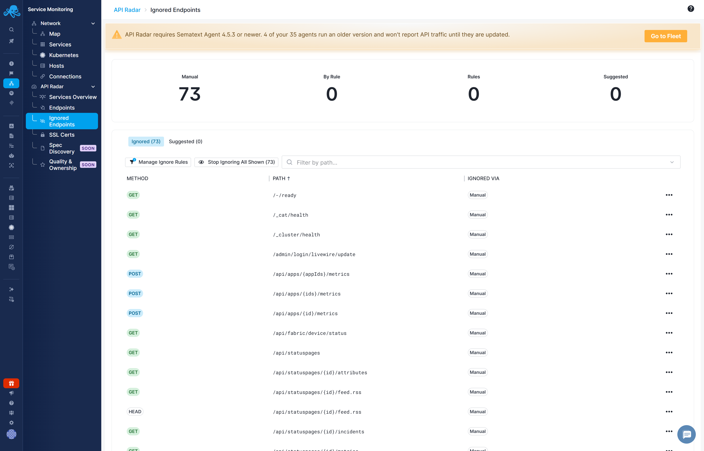

title: Ignored Endpoints
description: Reduce endpoint list noise with individual ignores and path-based rules

Use **Service Monitoring → API Radar → Ignored Endpoints** to review ignored entries and suggestions such as health checks. Ignored endpoints are excluded from the main reports, charts, and alert rule evaluation. Use this for health-check endpoints such as `/health` and `/healthz`, readiness-probe endpoints such as `/ready`, and similar endpoints whose traffic would add noise to reports. Ignoring an endpoint does not block API requests.

## Ignore an endpoint

In **Endpoints**, open a row's menu and select **Ignore Endpoint**. Use **Ignore All Shown** to act on the currently shown list; review the active search and filters before applying a bulk action.

Open **Ignored Endpoints** to review the ignored entries. Use **Unignore Endpoint** to include an endpoint in the main reports and alert rule evaluation again.

## Suggested noise

Suggested endpoints appear in the **Suggested** tab next to the **Ignored** tab above the endpoints table. The suggestions identify common health-check and probe paths, such as `/health`, `/healthz`, `/ready`, `/ping`, `/metrics`, `/status`, and `/live`. Review suggestions before ignoring them; these paths can still be important for an investigation.

## Ignore rules

On the **Ignored Endpoints** page, click **Manage Ignore Rules** above the table, to the left of the bulk action and path filter. Path-based rules let you handle a class of endpoints together. For example, a rule containing `/health` can cover matching health-check paths across services.

When adding a rule, review the matching entries and choose whether to apply it to existing endpoints too or only endpoints discovered later. When removing a rule, review whether affected endpoints should be restored or remain individually ignored.

<!-- Release check: verify case sensitivity, account/App scope, limits, historical metric behavior, summary totals, and how individual unignore interacts with path-based rules. The sketch implements a local UI list, not a collection backend. -->
