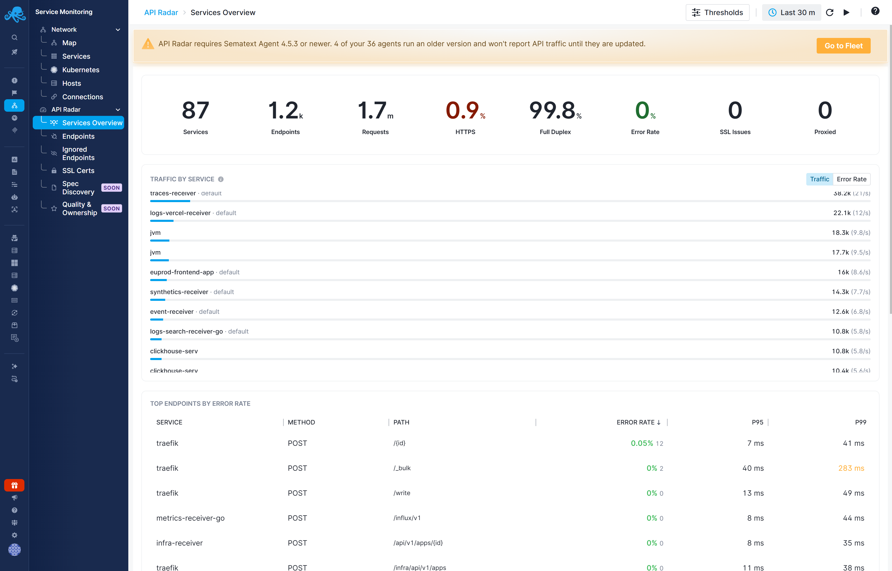

title: Services Overview
description: Review API traffic across services and find endpoints with server errors or high latency

Open **Service Monitoring → API Radar → Services Overview** for a summary of observed API activity in the selected time range.

## Summary

The summary includes **Services**, **Endpoints**, **Requests**, **HTTPS**, **Full Duplex**, **Error Rate**, **SSL Issues**, and **Proxied**. **Full Duplex** shows the percentage of traffic for which both requests and responses were observed, allowing API Radar to show response status codes, error rates, and latency. With **Egress Only**, only outgoing requests are observed: request activity is visible, but response status codes, error rates, and latency are unavailable.

The time picker and refresh controls determine the range shown in the report.

## Traffic by Service

The service chart shows which services account for observed request traffic. Switch between **Traffic** and **Error Rate** to compare volume with server errors. A busy service is not necessarily the service with the highest error rate.

## Top Endpoints by Error Rate

The endpoint table identifies the service, HTTP method, and path, with error rate and latency percentiles. Use it to find failing operations. Click the service row to open the corresponding endpoint details and inspect its status-code and latency breakdown.

See [Endpoints](endpoints.md) for metric definitions and observation limits.

