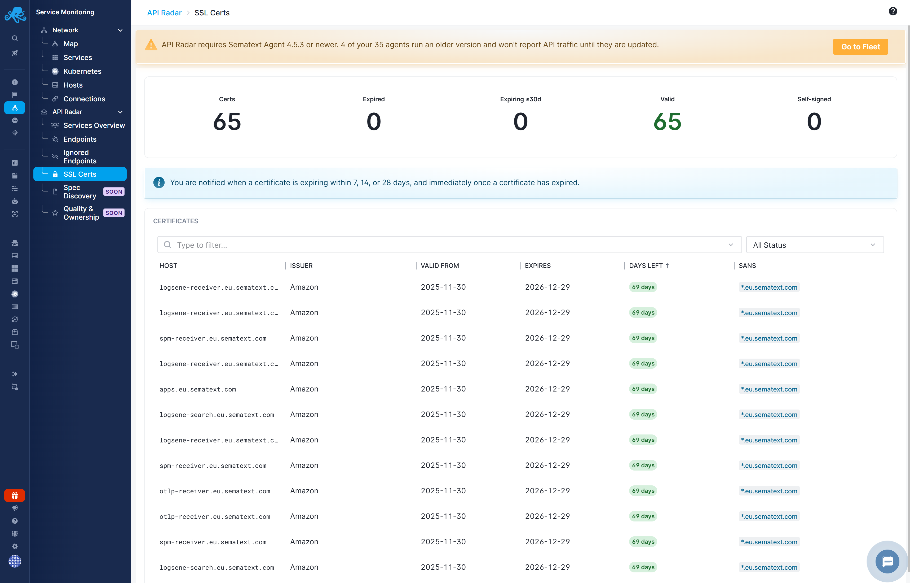

title: SSL Certificates
description: Review certificates observed by API Radar and identify upcoming expiry

Open **Service Monitoring → API Radar → SSL Certs** to review discovered certificates. This report reflects certificate information available from observed traffic.

## Certificate summary

The report summarizes total certificates, expired certificates, certificates expiring within 30 days, valid certificates, and self-signed certificates.

Use the search and status filter to find a host or focus on expiry. Sort by **Days Left** to prioritize certificates requiring attention.

## Certificate details

The table includes **Host**, **Issuer**, **Valid From**, **Expires**, **Days Left**, and **SANs** (Subject Alternative Names). The endpoint details panel's **SSL** tab also shows available certificate information.

Check the certificate's host and alternative names before deciding which service or domain requires renewal. A self-signed certificate is a separate property from expiry.

## Notifications

The default **Automatic - SSL certificate expiring** rule detects observed certificates expiring within 28 days. It is enabled by default and excludes endpoints marked as [Internal](endpoints.md#internal-endpoints). Configure recipients to receive notifications. Its analysis window is one hour, with a minimum of 24 hours between notifications and back-to-normal notifications configured. See [Thresholds & Alerts](thresholds-alerts.md).

