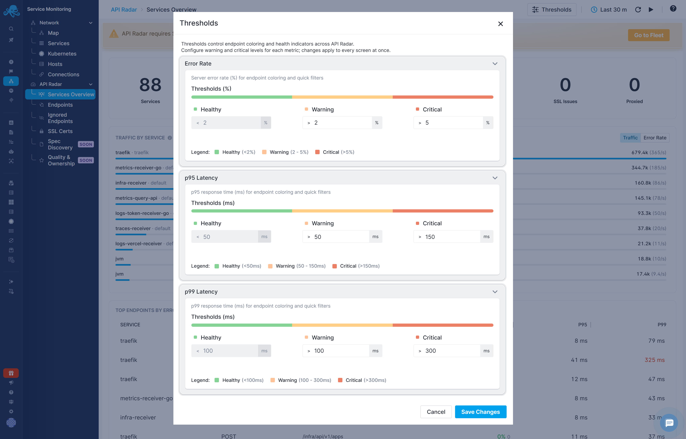
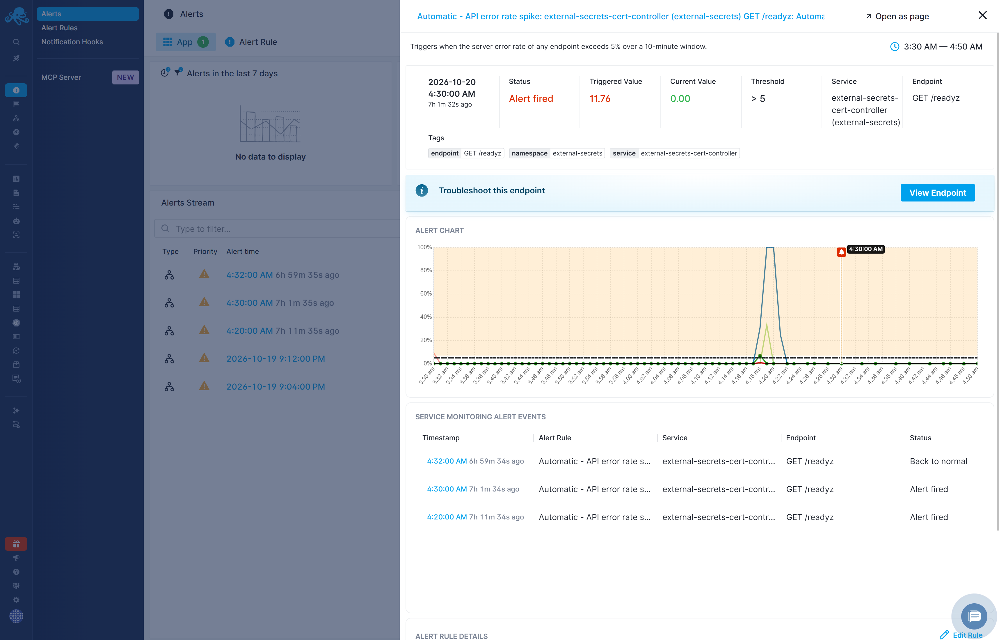
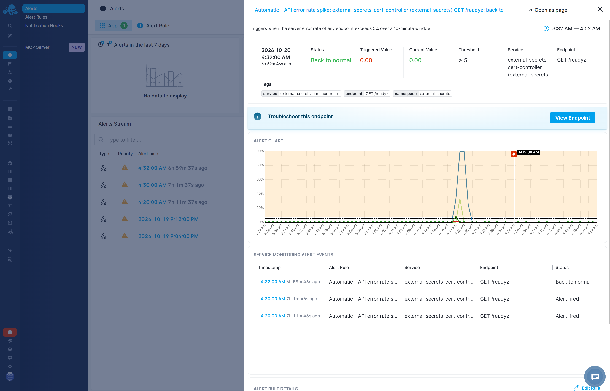

title: Thresholds & Alerts
description: Configure API Radar thresholds, default alert rules, and notifications for endpoint errors, latency, certificate expiry, and missing Authorization headers

API Radar provides metric thresholds for report coloring and filtering, and alert rules for detecting endpoint conditions. Configure alert rules separately from visual thresholds: changing a report's color bands does not change an alert rule's configured limit.

## Metric thresholds

Thresholds for **Error Rate**, **p95 Latency**, and **p99 Latency** control visual health bands and metric quick filters. Error rate is a percentage; latency thresholds are measured in milliseconds.

## Default alert rules

API Radar provides five account-level default rules. With no specific services or endpoints selected, they apply across services and endpoints in the account. Each triggered alert identifies the specific service and endpoint that met the condition. All five exclude endpoints marked as [Internal](endpoints.md#internal-endpoints).

Automatic - API error rate spike, Automatic - SSL certificate expiring, and Automatic - No auth header observed are enabled by default. The p95 and p99 latency rules are disabled by default; see [Set latency thresholds for your services](#set-latency-thresholds-for-your-services) for why and how to configure them.

| Rule | Condition | Analysis window | Priority | Enabled by default | Minimum notification interval |
|---|---|---|---|---|---|
| Automatic - API error rate spike | An endpoint's server error rate exceeds 5%. | 10 minutes | Error | Yes | 10 minutes |
| Automatic - SSL certificate expiring | An observed TLS certificate expires within 28 days. | 1 hour | Warning | Yes | 24 hours |
| Automatic - No auth header observed | An endpoint is called without an Authorization header. | 10 minutes | Warning | Yes | 1 hour |
| Automatic - API p95 latency | An endpoint's p95 latency exceeds 1,000 ms (1 second). | 10 minutes | Warning | No | 10 minutes |
| Automatic - API p99 latency | An endpoint's p99 latency exceeds 2,000 ms (2 seconds). | 10 minutes | Warning | No | 10 minutes |

The analysis window defines the period the rule examines. The minimum notification interval limits how often repeated notifications can be sent; it is not the analysis window or a guarantee of delivery at that interval.

## Set latency thresholds for your services

Expected latency varies between services and endpoints. A response time that is normal for one operation may indicate a problem for another, so the default p95 and p99 rules are provided as examples and remain disabled until you enable them.

Duplicate a latency rule, select the service or endpoint it should apply to, and configure a threshold appropriate for that operation. Review the analysis window and notification settings, then enable the rule. Create separate rules where services or endpoints need different latency limits.
## Notifications and recovery

All five default definitions have notifications and back-to-normal notifications configured. 

