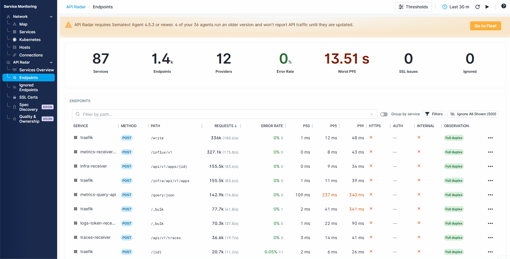

title: Service Monitoring
description: Explore service connections and API traffic with Network Map and API Radar

Service Monitoring automatically discovers services, network connections, and HTTP API endpoints from traffic observed by [Sematext Agent](../agents/sematext-agent/index.md), without requiring code instrumentation. Use **Network** to explore service dependencies and **API Radar** to identify endpoints with high error rates or slow responses.

## Why use it

- **Find dependencies.** Network Map shows observed connections between services, hosts, and Kubernetes workloads.
- **Find slow or failing endpoints.** API Radar shows request volume, server errors, and response-time percentiles by endpoint.
- **Get alerted about API issues.** Use [API Radar alert rules](api-radar/thresholds-alerts.md) for elevated server errors, slow responses, upcoming certificate expiry, and missing Authorization headers. Configure notification recipients to receive alerts identifying the affected service and endpoint.
- **Discover services and API endpoints automatically.** Install Sematext Agent on your hosts to discover services, network connections, and API endpoints as traffic is observed, without configuring each service or endpoint separately.
- **Review transport security.** Inspect observed HTTPS usage and discovered certificate validity.
- **Move between API and network context.** Open an endpoint's network context or inspect a service from either feature.

## Network

Open **Service Monitoring → Network**. The **Map** has Services and Infrastructure views. **Services**, **Kubernetes**, **Hosts**, and **Connections** provide tabular views of the discovered topology.

See [Network Map](../network-map/index.md) for topology, filtering, thresholds, and supported service types.

## API Radar

Open **Service Monitoring → API Radar**. Start with [Services Overview](api-radar/services-overview.md), inspect individual [Endpoints](api-radar/endpoints.md), manage [Ignored Endpoints](api-radar/ignored-endpoints.md), or review [SSL Certs](api-radar/ssl-certificates.md).

See [API Radar](api-radar/index.md) for endpoint metrics and investigation workflows.

## From discovery to investigation

1. **Discover services and endpoints.** Install [Sematext Agent](../agents/sematext-agent/index.md) to discover network connections and HTTP API endpoints automatically, without code instrumentation.
2. **Find the affected endpoint.** Use API Radar to identify high error rates or slow responses, then inspect the endpoint's metrics and network dependencies to narrow down the problem.
3. **Investigate inside the application.** For deeper analysis, instrument the affected service with [OpenTelemetry](../tracing/sdks/index.md) and send its [traces](../tracing/index.md) to Sematext. Follow individual requests through the application to identify operations contributing to errors or delays.

Start with automatically discovered API and network data, then add tracing to the services that need deeper investigation.

## Getting started

See [Getting Started](getting-started.md) for requirements and verification. Network and API Radar have different minimum Sematext Agent versions; a host reporting topology does not necessarily report API traffic.

