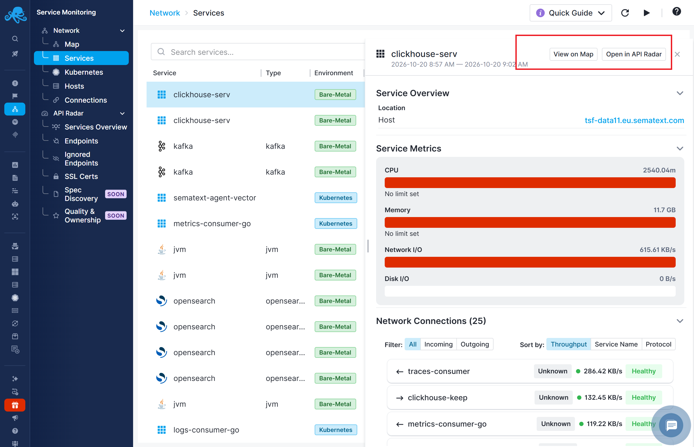
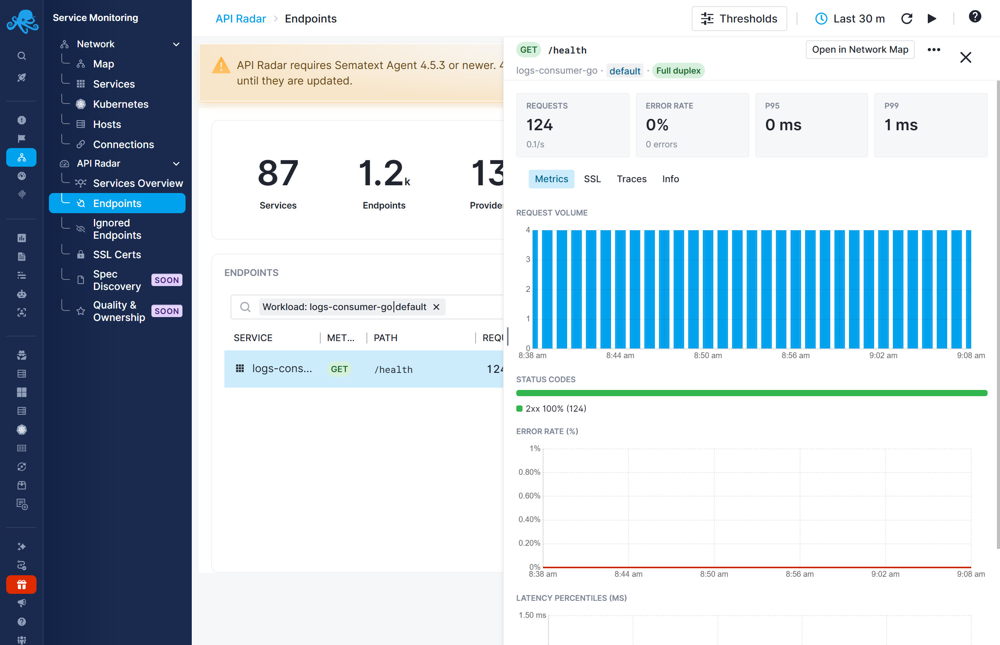
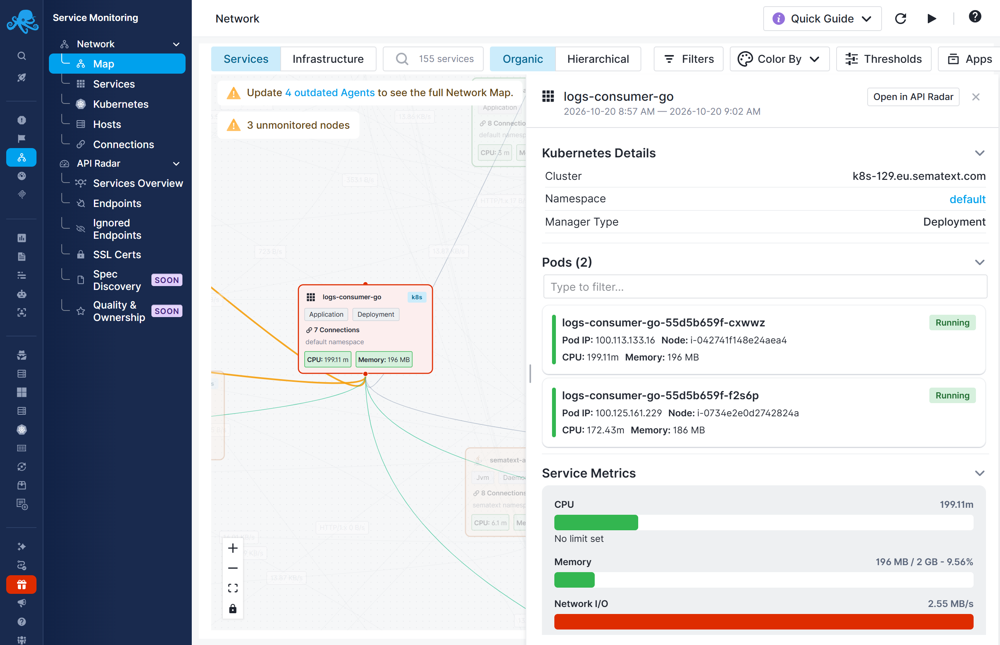

title: Service Details
description: Investigate a service using its API activity and network context

Service details connect the network and API views of a service. You can start from a service in Network Map or from API Radar and follow the available links to its related activity.

## Start from Network

Open **Service Monitoring → Network → Map** or **Services**, then select the service. Review its deployment and connection context before following links to related API activity.

See [Services View](../network-map/services-view.md) and [Tabular Views](../network-map/tabular-views.md) for the network details panels.

## Start from API Radar

Open **Service Monitoring → API Radar → Services Overview** or **Endpoints**. Find the service and inspect its endpoints. Endpoint details provide request metrics and an **Open in Network Map** action for investigating the associated network context.

An endpoint details panel describes a particular method and path. A service details panel describes the service itself. Use the former to investigate an API operation and the latter to investigate the service and its dependencies.

<!-- Release check: confirm final shared service details tabs and labels against production. Do not copy mock endpoint tabs into the service panel description. -->

## Assess the potential blast radius

A slow or failing service can affect the services that depend on it. The potential blast radius is the set of services and workflows that could be affected, directly or through a chain of dependencies.

For example, API Radar may show elevated latency on a payment endpoint. Open **Network Map** from the endpoint details to investigate:

1. Identify services with connections **to the payment service**, such as checkout or subscription processing. These callers may be affected by its slowdown.
2. Follow the dependency chain to identify other services that could be affected.
3. Check those services for corresponding errors or delays to distinguish potential impact from observed problems.

Use the service details panel's **Network Connections** section to inspect incoming connections. See [Services View](../network-map/services-view.md#investigating-a-service) for how to identify callers and connection direction.

**Investigate inside the application.** For deeper analysis, instrument the affected service with [OpenTelemetry](../tracing/sdks/index.md) and send its [traces](../tracing/index.md) to Sematext. Follow individual requests through the application to identify operations contributing to errors or delays.

Start with automatically discovered API and network data, then add [tracing](../tracing/index.md) to the services that need deeper investigation.
